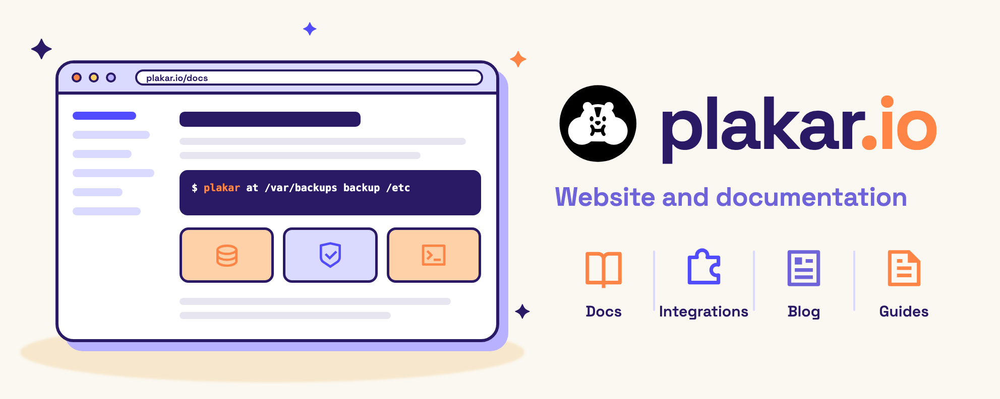

<div align="center">



# plakar.io

**The website and documentation for
[Plakar](https://github.com/PlakarKorp/plakar).**

Product pages, integrations, the blog, and the Community and Control Plane docs
served at [plakar.io](https://www.plakar.io).

[](https://plakar.io/discord)
[](https://www.youtube.com/@PlakarKorp)
[](https://www.reddit.com/r/plakar/)

</div>

## What is this?

plakar.io is a static site built with [Hugo](https://gohugo.io) and the
[Blowfish](https://blowfish.page) theme, styled with Tailwind CSS and searched
with [Pagefind](https://pagefind.app). Every push to `main` publishes the site.

If you are looking for the backup tool itself, see
[PlakarKorp/plakar](https://github.com/PlakarKorp/plakar). If you want to fix a
typo, improve a page, or document an integration, you are in the right place.

## Quickstart

```sh
# Clone with the Blowfish theme submodule
git clone --recurse-submodules git@github.com:PlakarKorp/plakar.io.git
cd plakar.io

# Install dependencies for the theme and the site
(cd themes/blowfish && npm install)
npm install

# Start the dev server with live reload
npm run dev
```

The site is then served at http://localhost:1313.

If you cloned without `--recurse-submodules`, fetch the theme with
`git submodule update --init --recursive`.

## Requirements

- [Hugo](https://gohugo.io/installation/) extended, 0.160.1 (the version CI
  uses)
- Node.js 24 (see `.node-version`)
- [codespell](https://github.com/codespell-project/codespell), optional, for
  spell checking (`brew install codespell`)

## Commands

| Command                | What it does                                                  |
| ---------------------- | ------------------------------------------------------------- |
| `npm run dev`          | Build once, then run the Hugo server and the Tailwind watcher |
| `npm run build`        | Build Tailwind, the site, and the Pagefind search index       |
| `npm run check:links`  | Build the site and check every internal link and anchor       |
| `npm run codespell`    | Check for common spelling mistakes                            |
| `npm run format`       | Format the codebase with [Prettier](https://prettier.io)      |
| `npm run format:check` | Check formatting without writing changes                      |

CI runs the link check and codespell on every pull request. You can run the
workflows locally with [act](https://github.com/nektos/act): `act push`.

## Repository layout

| Path                          | Contents                                                    |
| ----------------------------- | ----------------------------------------------------------- |
| `content/docs/community/`     | Community docs, one directory per minor version plus `main` |
| `content/docs/control-plane/` | Control Plane docs, not versioned                           |
| `content/integrations/`       | Integration pages listed at `/integrations/`                |
| `content/posts/`              | Blog posts                                                  |
| `layouts/`                    | Templates and overrides of the Blowfish theme               |
| `assets/`                     | CSS, images, and the compiled Tailwind output               |
| `scripts/`                    | Link checker and generators for reference docs              |
| `themes/blowfish/`            | The Blowfish theme, as a submodule. Do not edit it          |

To change a theme template, copy it from `themes/blowfish/layouts/` into
`layouts/` at the same path and edit the copy.

## Writing documentation

Community docs live under `content/docs/community/<version>/`. `main` holds the
docs for the next release. Each released minor version has its own directory,
and patch releases update that directory in place.

Pick the section by what the reader needs:

| Section             | For                       | Examples                                   |
| ------------------- | ------------------------- | ------------------------------------------ |
| **Getting Started** | New users                 | Installation, first backup                 |
| **Guides**          | Solving a specific task   | Back up PostgreSQL, schedule daily backups |
| **References**      | Looking up exact details  | CLI commands, configuration, flags         |
| **Explanations**    | Understanding concepts    | How Plakar works, backup strategies        |
| **Integrations**    | Connecting other services | S3, SFTP, PostgreSQL, Google Drive         |

### Generated references

Some reference pages are generated from other repositories. Regenerate them with
the scripts in `scripts/` rather than editing them by hand:

| Script                    | Regenerates                                       |
| ------------------------- | ------------------------------------------------- |
| `update-cli-doc.sh`       | Plakar CLI command reference                      |
| `update-api-doc.sh`       | Control Plane OpenAPI schema in `static/openapi/` |
| `update-terraform-doc.sh` | Terraform provider reference                      |
| `update-ansible-doc.sh`   | Ansible collection reference                      |
| `update-operator-doc.sh`  | Kubernetes operator reference                     |

## Contributing

Open a pull request against `main`. Before you push, run:

```sh
npm run format
npm run codespell
npm run check:links
```

Found a mistake on the site? Open an issue:
https://github.com/PlakarKorp/plakar.io/issues

## Community

- [Discord](https://plakar.io/discord)
- [Reddit](https://www.reddit.com/r/plakar/)
- [YouTube](https://www.youtube.com/@PlakarKorp)
