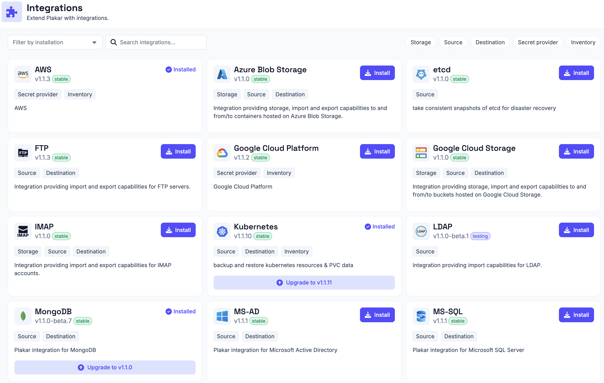

# Integrations

An integration gives Plakar Control Plane support for an external system. There
are five kinds:

- **Inventory**: discovers resources from a provider, for an
  [inventory](../inventories).
- **Secret provider**: supplies credentials from an external secret manager, as
  a [secret provider](../secret-providers).
- **Source**: backs up a resource.
- **Store**: holds backups on a resource.
- **Destination**: restores data to a resource.

A single integration can provide several of these. Plakar Control Plane only
works with systems whose integration is installed.

An installed integration is offered wherever it applies. Inventory and secret
provider integrations are listed when an inventory or a secret provider is
created. Source, store and destination integrations are offered when an
[app](../apps) is set up on a compatible resource, where compatibility is
decided by the class and subclass of the resource. When several installed
integrations match a resource, the one an app uses is chosen when the app is set
up.

Viewing, installing and upgrading integrations requires the matching
[permissions](../access-control/permissions).

## Installing an integration

Integrations are installed from the **Integrations** page. Inventory providers
can also be installed from the **Add inventory** dialog, which lists providers
that are not installed alongside those that are, so an inventory can be created
without visiting the **Integrations** page first.

## Updating an integration

When a newer version of an installed integration is available, its card on the
**Integrations** page offers an **Upgrade**, which installs the newer version.
