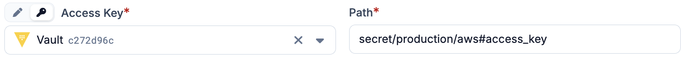

# Secret providers

Plakar Control Plane handles sensitive credentials like tokens, passwords, and
more. When configuring an app, inventory, or any other resource that requires a
credential, Plakar Control Plane gives you two options.

- **Direct value:** stores the credential directly in the Plakar Control Plane
  database. This is the simplest option and works well for most setups.
- **Secret provider:** delegates the credential resolution to an external secret
  manager. Instead of storing the value itself, Plakar Control Plane stores a
  path that points to the secret in your secret manager, and resolves it at
  runtime.

Secret providers belong to a single organization. You work only with the secret
providers of the organization you signed in to, and what you can do with them is
determined by the [permissions](../access-control/permissions) you hold there.

Using a secret provider is recommended if your organization already manages
credentials centrally, if you want to avoid storing sensitive values in the
database, or if credentials have to be rotated.

## Rotating secrets

Credentials such as API keys and application credentials often expire or have to
be replaced on a schedule. How a rotation is carried out depends on how the
credential is provided.

A direct value is a copy of the credential, held in the Plakar Control Plane
database. When the credential is replaced, every app, inventory or other
resource that holds the old value has to be updated by hand. Until it is, tasks
that use it fail, including scheduled backups.

A secret provider holds the credential in one place, outside Plakar Control
Plane. Plakar Control Plane stores only the path to the secret and resolves it
each time the credential is needed, so it always uses the current value. A
rotation is done once, in the secret manager, and every resource that points to
the secret picks up the new value without any change in Plakar Control Plane.

## Setting up a secret provider

Before you can use a secret provider, you need to configure one. See the
provider-specific instructions for your secret manager:


