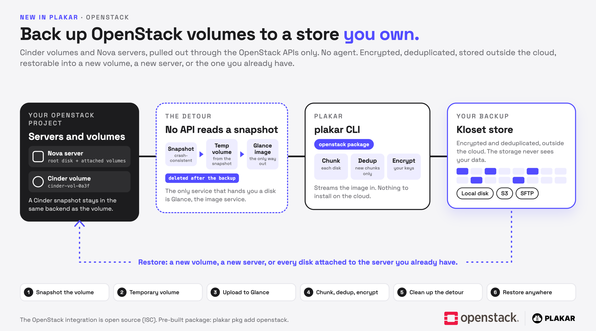

---
title:
  "Take a Glance: Plakar's OpenStack backup is now free in Plakar Community"
summary:
  "Plakar's OpenStack backup is now free in Plakar Community (OSS): back up and
  restore Cinder volumes and Nova servers through the OpenStack APIs. No agent.
  Encrypted and deduplicated."
slug: "backing-up-openstack-with-plakar"
date: "2026-10-22T00:00:00+14:00"
authors:
  - "peeyush"
tags:
  - integration
  - openstack
  - nova
  - cinder
  - backup
category: "technology"
featured-scope:
  - header
---

**TL;DR:**

> Our OpenStack integration, which first shipped in Plakar Control Plane, is now
> free for everyone in Plakar Community (OSS). It backs up and restores Cinder
> volumes and Nova servers through the OpenStack APIs only, with no agent to
> install. Backups are encrypted, deduplicated and stored outside the cloud, on
> any OpenStack cloud, OVHcloud Public Cloud included.

---

## Why we built an OpenStack integration, and why we are making it free

We built this integration first and foremost because a large part of Europe's
independent cloud runs on OpenStack: OVHcloud, Open Telekom Cloud, Cleura,
Exoscale, etc. In the US the picture is different. AWS, Azure and Google Cloud
run their own stacks, but OpenStack is still common inside the private clouds of
large companies, in the telco and higher education sectors for instance.
Wherever it runs, it holds data that needs a real backup. The good news is that
OpenStack offers truly open APIs, so you can move from one provider to another.

If you are reading this post, you might be asking yourself: OpenStack already
has snapshots, why do I need more? A Cinder snapshot is fast and cheap, but it
lives in the same Cinder backend as the volume it protects. If that backend is
lost, wiped or encrypted by an attacker, the snapshot goes with it. The way we
see it, a backup should be offsite, and you have to hold the keys.

That is also why we are making it free. The integration was first shipped in
Plakar Control Plane; today it is available to everyone in Plakar Community
(OSS). If strategic autonomy is why you chose OpenStack, you should be able to
back it up without asking anyone.

## How Plakar backs up OpenStack volumes

Here is the thing about OpenStack: no API reads a snapshot's bytes. The only
service that will hand you a disk is Glance, the image service. So every backup
takes a detour. (Yes, that is where the title comes from.)



### A volume backup in four steps

1. Plakar snapshots the volume. If the volume is in use, the copy is
   crash-consistent: what you would get after pulling the power cord.
2. It creates a temporary volume from the snapshot and uploads it to Glance as
   an image.
3. It streams the image into Plakar, which chunks it, keeps only the chunks it
   has never seen, then compresses and encrypts them into a
   [Kloset store](/posts/2025-04-29/kloset-the-immutable-data-store/).
4. It deletes the image, the temporary volume and the snapshot. Cinder is not
   always ready to delete right away, so Plakar waits up to 15 minutes for each
   one.

### Servers, restores and limits

A Nova server is the same path, once per disk, plus its flavor and networks.
Restore goes the other way: into a new volume, into a new server (in another
project or region if you want), or onto the server you already have.

## Getting started

So, to sum up: Plakar talks to the OpenStack APIs (Keystone, Cinder, Nova and
Glance) with an application credential, so nothing is installed in your cloud or
in your guests. It works on any OpenStack cloud; on OVHcloud Public Cloud, you
create the application credential in the Horizon dashboard and you are done. And
the OpenStack integration is now free for everyone in Plakar Community (OSS).

[Download Plakar](/download/), then install the package (pre-built packages need
a free Plakar account):

```bash
$ plakar login
$ plakar pkg add openstack
```

Back up a volume, then restore it into a new one:

```bash
$ plakar source add myvol openstack-block://<volume-id> \
    openstack_auth_url=https://keystone.example.com:5000/v3 \
    openstack_application_credential_id=<id> \
    openstack_application_credential_secret=<secret> \
    openstack_region=RegionOne
$ plakar backup @myvol
$ plakar destination add myvoldst openstack-block://spawn <same options>
$ plakar restore -to @myvoldst <snapshot-id>
```

For a server, use `openstack-instance://<server-id>` instead. The rights each
connector needs are in the
[OpenStack docs](/docs/community/main/integrations/openstack/).

Happy hacking!
