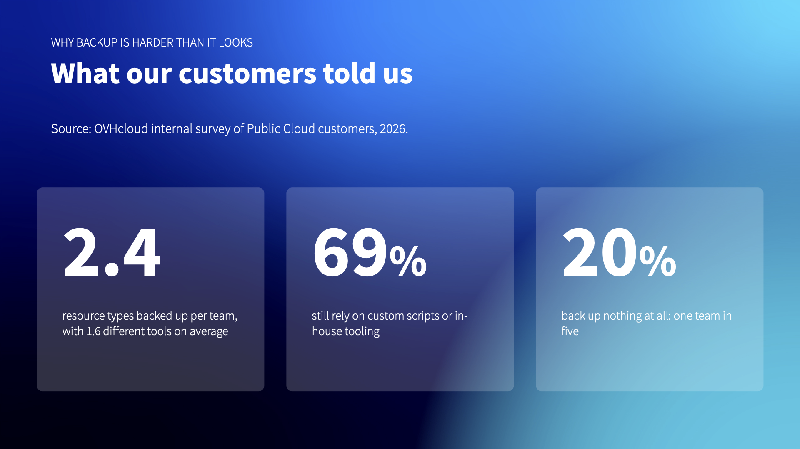
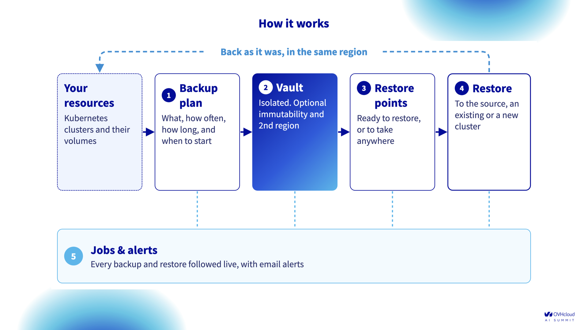
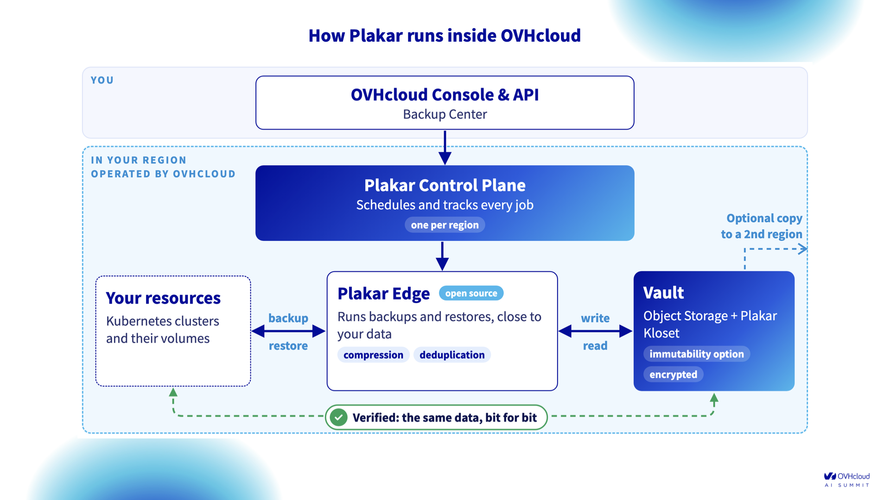

Last week at the [OVHcloud AI Summit](https://summit.ovhcloud.com/) in Paris,
OVHcloud presented Backup Center: backup built into the OVHcloud Console and
API, running on Plakar.

Gilles Chehade, our co-founder, presented it on stage with Antoine Ruelle (IT
Director, OVHcloud) and Arthur Cabot (Product, OVHcloud). It builds on the
partnership
[OVHcloud and Plakar announced in September](https://corporate.ovhcloud.com/en/newsroom/news/ovhcloud-and-plakar-integrate-backup-natively-public-cloud/).
Here is what they showed, and how it works underneath.

## Why backup is harder than it looks

Most teams don't have one backup. They have several: scripts for this, Velero
for that, a vendor tool for the database. Each resource type gets its own
method, nobody really knows what is protected and restore are often not tested
until sh*t hits the fan.

OVHcloud surveyed its Public Cloud customers this year. Teams back up 2.4
resource types on average, with 1.6 different tools. 69% still rely on custom
scripts or in-house tooling. 20% back up nothing at all.

That last number matters more than ever. As our CEO Julien Mangeard puts it:
"Attacks now eventually succeed: backup is no longer a company's last line of
defense, it is the first."

OVHcloud's answer is to treat backup as part of the cloud itself. "Backup is a
core cloud function, just like compute or networking," said Yaniv Fdida, Chief
Product & Technology Officer at OVHcloud. "We are integrating it natively, true
to our principles of openness and reversibility."

## What Backup Center does

One console, three jobs:

- **Set up.** Protect a cluster with a backup plan. Pick one of four templates
  (daily backups, kept 14, 30, 180 or 365 days), choose a start date and time
  slot, and apply it to several clusters at once. The same features work from
  the OVHcloud Control Panel, the API and Terraform.
- **Monitor.** See at a glance which clusters, namespaces and volumes are
  protected. Every backup and restore is followed live in Jobs: see why a job
  failed, and retry it.
- **Restore.** Pick a restore point and bring back the whole cluster, selected
  namespaces (with or without their volumes) or a single volume, to the source
  cluster, an existing one or a new one.

In the Beta, a protected cluster gets its Kubernetes objects (Deployments,
Services, Namespaces, ConfigMaps and application Secrets) and its Block Storage
persistent volumes backed up. Namespaces and volumes added later are picked up
automatically. Databases running inside the cluster, such as CloudNativePG or
MariaDB, are backed up with their volumes, crash-consistent: they restore as
after a sudden power loss, not from a database dump.

Backups land in one vault per region, created with your first plan. It is
isolated from your resources, immutable for 14 days by default, and encrypted
with OVHcloud-managed keys.

Not in the Beta yet: on-demand backups, a copy to a second region, email alerts
and customer-managed encryption keys. OVHcloud lists the full scope on the
[Backup Center Labs page](https://labs.ovhcloud.com/en/backup-center/).

## Under the hood

Backup Center is the OVHcloud interface. Plakar does the backup work behind it,
and all of it runs in your region, operated by OVHcloud:

- **[Plakar Control Plane](https://www.plakar.io/docs/control-plane/)**
  schedules and tracks every job. There is one per region, so scheduling stays
  next to the data it protects.
- **Backups run close to your data.** They are compressed and deduplicated
  before they leave the cluster, so each backup only stores what changed since
  the last one.
- **The vault** is
  [OVHcloud Object Storage](https://www.ovhcloud.com/en/public-cloud/object-storage/)
  holding a Kloset, Plakar's
  [snapshot format](https://github.com/PlakarKorp/kloset). Snapshots are
  encrypted and can be made immutable.
- **Every snapshot is verified.** Change a single bit in the vault and it is
  detected. When you restore, you get back the same data, bit for bit.

We built it this way for one reason: your backups should not depend on us, or on
any single provider, to be readable.

## Open and reversible

Backup Center runs on the
[open-source Plakar engine](https://github.com/PlakarKorp/plakar). The format
your backups are written in is public, and the tools to read it are open source.
You can restore your data elsewhere, even outside OVHcloud, whenever you choose.
And OVHcloud charges no egress fees, so getting your data back costs nothing
extra in transfer.

To be precise about what is open: the engine and the Kloset format are open
source. Plakar Control Plane, which schedules the jobs, is not. Your backups
stay readable and restorable with the open-source engine, with or without the
Control Plane.

## What comes next

- **General availability, early 2027:** Managed Kubernetes, in the Console and
  the API, Europe first.
- **Later in 2027:** Public Cloud instances, then Object Storage and File
  Storage.

If you run
[Managed Kubernetes](https://www.ovhcloud.com/en/public-cloud/kubernetes/) on
OVHcloud,
[pre-register for the Beta](https://labs.ovhcloud.com/en/backup-center/) now.
Places are limited.

If you want to start before then, or protect something Backup Center doesn't
cover yet, Plakar already runs on OVHcloud today: see our
[OVHcloud integration](https://www.plakar.io/integrations/ovhcloud/) and the
[setup guide](https://www.plakar.io/docs/community/main/guides/ovhcloud/). For
Kubernetes, read how we
[back up clusters with Plakar](https://www.plakar.io/posts/2026-02-18/backing-up-kubernetes-clusters-with-plakar/)
and how the
[Kubernetes Operator](https://www.plakar.io/posts/2026-09-23/resilience-as-code-kubernetes-operator/)
turns backup into code. And if you like the idea of backups you can always read
without us, [a star on GitHub](https://plakar.link/ovh-star) helps.

The session was recorded. We'll add the replay here once OVHcloud publishes it
on the [Summit website](https://summit.ovhcloud.com/).
