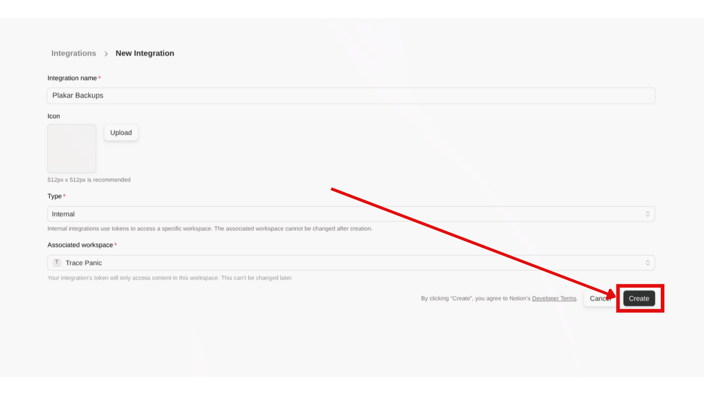
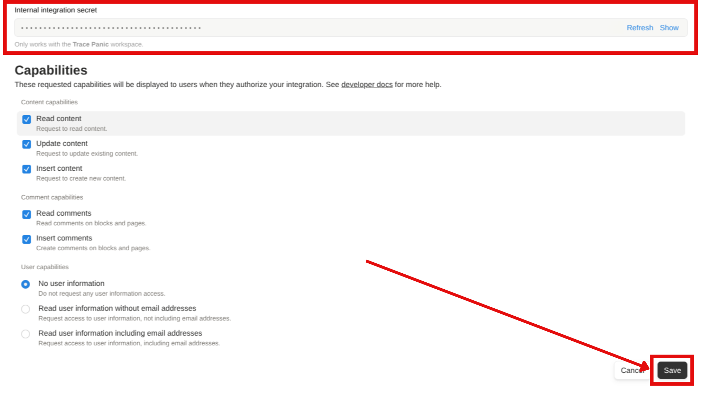
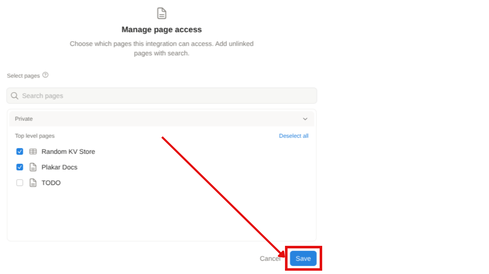

# Notion

> [!WARNING]+ This integration is currently in beta
>
> This integration has not yet reached a stable release. It is functional for
> testing and evaluation but should not be relied upon for production use cases.
>
> See [Limitations and scope](#limitations-and-scope) for current known issues.

The Notion integration backs up and restores Notion workspaces through the
official Notion API. Workspace content, including pages, databases, blocks and
their hierarchical relationships, is captured as structured JSON and stored in a
Kloset store.

The integration includes two connectors:

| Connector type            | Description                                     |
| ------------------------- | ----------------------------------------------- |
| **Source connector**      | Back up a Notion workspace into a Kloset store. |
| **Destination connector** | Restore a Notion workspace from a Kloset store. |

**Requirements**

- An internal Notion integration created in the workspace, with the capabilities
  described in [Notion API setup](#notion-api-setup).
- The API token of that integration.
- At least one page shared with the integration.
- For restores, a target page shared with the integration, and its Page ID.

## Installation

The Notion package can be installed using pre-built binaries or compiled from
source.





Pre-compiled packages are available for common platforms and provide the
simplest installation method.

> [!NOTE]+ Logging In
>
> Pre-built packages require Plakar authentication. See
> [Logging in to Plakar](../../guides/logging-in-to-plakar) for details.

Install the Notion package:

```bash
$ plakar pkg add notion
```

Verify installation:

```bash
$ plakar pkg show
```





Source builds are useful when pre-built packages are unavailable or when
customization is required.

**Prerequisites:**

- Go toolchain compatible with your **Plakar** version

Build the package:

```bash
$ plakar pkg build notion
```

A package archive will be created in the current directory (e.g.,
`notion_v1.0.0_darwin_arm64.ptar`).

Install the package:

```bash
$ plakar pkg add -allow-unsigned ./notion_v1.0.0_darwin_arm64.ptar
```

Verify installation:

```bash
$ plakar pkg show
```





To list, upgrade, or remove the package, see
[managing packages guide](../../guides/managing-packages/).

## Notion API setup

Plakar accesses a workspace through an internal integration created in that
workspace. The integration's capabilities determine what Plakar can read and
write, and only pages shared with it are visible to Plakar.

### Create a Notion integration

1. Go to
   [https://www.notion.so/profile/integrations](https://www.notion.so/profile/integrations).
2. Click **Create a new integration**.
3. Configure the integration:
   - **Name**: a descriptive name (e.g., "Plakar Backup")
   - **Type**: **Internal**
   - **Associated workspace**: the workspace to back up
4. Click **Create** to create the integration.
5. Click **Configure integration settings** in the success popup.



### Configure integration capabilities

In the **Capabilities** section of the integration settings page, enable the
following capabilities, then click **Save**:

- **Read content**: required for backing up pages and databases
- **Update content**: required for restoring pages and databases
- **Insert content**: required for restoring pages and databases
- **Read comments**: required for backing up discussion threads
- **Insert comments**: required for restoring discussion threads



### Copy the API token

The token section is on the integration settings page, just before the
**Capabilities** section. Click **Show** on the "Internal Integration Secret"
and copy the token (format: `ntn_xxx...`).

> [!NOTE]+ Notion Token
>
> Keep this token secure. Anyone with this token can access and modify pages
> that have been shared with this integration.

### Share pages with the integration

The integration must be given access to top-level pages:

1. Click **Edit Access**.
2. Select the top-level pages and databases to back up.
3. Click **Save**.



> [!NOTE]+ Sharing Pages
>
> Once a page is shared with the integration, all child pages are automatically
> included during backup. Only top-level pages need to be shared.

## What is backed up

A backup captures the following content from every page shared with the
integration:

- **Pages**: all content, blocks, and page properties
- **Databases**: structure, properties, views, and all entries
- **Media**: images, files, and embedded content (stored as references)
- **Comments**: discussion threads and annotations
- **Metadata**: creation dates, authors, last edited information
- **Relationships**: parent-child hierarchies and database links

## Configuration

The source connector retrieves workspace data through the Notion API and stores
it as structured JSON, including page content, databases, blocks, metadata and
hierarchical relationships. The destination connector reads that JSON from a
Kloset store and recreates pages and content in Notion through the API, under an
existing target page.

#### Backup flow

<!-- prettier-ignore-start -->

flowchart LR

subgraph Source["Notion"]
  FS["Data"]
end

Plakar["Plakar"]

Via["Retrieve data via<br/>Notion source connector"]

Transform["Transform data as a structured JSON document"]

Store["Kloset Store"]

FS --> Via --> Plakar --> Transform --> Store

<!-- prettier-ignore-end -->

#### Restore flow

<!-- prettier-ignore-start -->

flowchart LR

Store["Kloset Store"]

Plakar["Plakar"]

Transform["Reconstruct data from structured JSON document"]

Via["Restore data via<br/>Notion destination connector"]

subgraph Destination["Notion"]
  FS["Data"]
end

Store --> Plakar --> Transform --> Via --> FS

<!-- prettier-ignore-end -->

### Shared configuration

The following options apply to both source and destination connectors.

| Option     | Required | Description                                                                                                |
| ---------- | -------- | ---------------------------------------------------------------------------------------------------------- |
| `location` | Yes      | Must be set to `notion://`                                                                                 |
| `token`    | Yes      | Notion API token (format: `ntn_xxx...`). A destination connector requires a token with insert permissions. |

### Destination configuration

The following extra option is required by destination connectors.

| Option   | Required | Description                                   |
| -------- | -------- | --------------------------------------------- |
| `rootID` | Yes      | Notion Page ID where content will be restored |

The Page ID identifies the page under which the backup contents are restored. To
find it, open the page in Notion, click **Share** in the top right, then **Copy
link**. The URL has the format `https://www.notion.so/PageName-PAGE_ID`, and the
Page ID is the long alphanumeric string after the last dash. For example, in
`https://www.notion.so/MyPage-1234567890abcdef1234567890abcdef`, the Page ID is
`1234567890abcdef1234567890abcdef`.

### Example

Create a Notion source configuration and back up the workspace to a Kloset
store:

```bash
$ plakar source add mynotion location=notion:// token=$NOTION_API_TOKEN

$ plakar at /var/backups backup "@mynotion"
```

Create a Notion destination configuration, set the target page ID, and restore a
snapshot:

```bash
$ plakar destination add mynotion location=notion:// token=$NOTION_API_TOKEN

$ plakar destination set mynotion rootID=$NOTION_PAGE_ID

$ plakar at /var/backups restore -to "@mynotion" <snapshot_id>
```

## Limitations and scope

Each top-level page must be manually shared with the integration. Pages that are
not explicitly shared are not backed up, even if they are linked from shared
pages.

Some third-party or custom Notion blocks may not serialize perfectly. All
standard Notion blocks are fully supported.

Due to Notion API limitations, media files (images, PDFs, documents) cannot be
restored directly. Media can be restored to the filesystem and re-uploaded
manually.

Restoring requires an existing Notion Page ID as the destination. The API does
not support creating new top-level pages.

