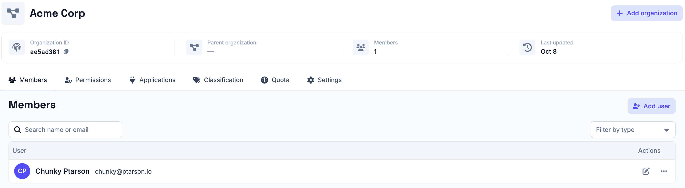
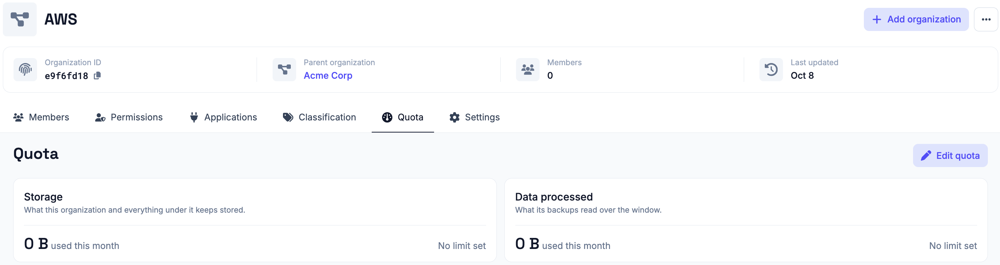

# Managing Organizations

Organizations partition a Plakar Control Plane instance into isolated
administrative domains. They allow a single deployment to manage multiple teams,
business units, customers, or environments while keeping their configuration and
operational data separate.

Every Plakar Control Plane deployment contains a root organization that is
created during the [initial setup (enrollment)](../../intro/enrollment).
Additional organizations can be created beneath it, forming a hierarchy. Each
organization has a single parent and may contain any number of child
organizations.

For example:

```text
Root
├── AWS
│   ├── S3
│   └── EC2
└── VMware
    ├── Production
    └── Development
```

This hierarchy can be extended to any depth, allowing organizations to be
structured in whatever way best matches your operational or administrative
requirements.

## Organization isolation

Every object in Plakar Control Plane belongs to a single organization. This
includes [inventories](../../inventories), [apps](../../apps),
[policies](../../compliance/policies), and most other configuration and
operational objects.

[Users](../users) are the exception. A user identity is shared across the whole
deployment and is identified by an email address. What is scoped to an
organization is the user's membership of it, along with the permissions granted
there.

An organization's [settings](../organization-settings) are scoped the same way,
so each organization is configured independently of the others. Every other
object is scoped to the organization in which it was created. Users operating
within an organization can view and manage only the objects that belong to that
organization.

For example, if separate **AWS** and **VMware** organizations exist beneath the
root organization, users operating in the **AWS** organization cannot view or
manage VMware inventories, resources, jobs, or other objects. Likewise, users in
the **VMware** organization cannot reach anything owned by **AWS**.

## Organization context

Users always work within one organization at a time. Only the inventories, apps,
tasks and other objects of that organization are visible, and what can be done
with them depends on the role held there, described in
[permissions](../permissions).

Signing in places the user on one organization of the organization tree. See
[signing in](../../intro/signing-in) for how the account selects it. After
signing in, the user is in that organization, and the organization selector at
the top of the sidebar switches to any organization below it in the tree, at any
depth. Organizations elsewhere in the tree are not reachable from the session.

<!-- prettier-ignore-start -->

flowchart TD
  Root["Root"] --> A["Organization A"]
  Root --> B["Organization B"]
  A --> A1["A.1"]
  A --> A2["A.2"]
  B --> B1["B.1"]
  B --> B2["B.2"]

<!-- prettier-ignore-end -->

In this tree, a user signed in to **Organization A** can work in A, A.1 and A.2,
and switch between them from the selector. Signed in to **A.1**, the same user
only reaches A.1. Reaching **Organization B** or its sub-organizations requires
signing in to B, which requires being a member of B. A member of the root
organization can scope to every organization in the tree.

Reaching an organization does not grant anything in it. What a user can see and
do in each organization depends on the [permissions](../permissions) they hold
there, so a member of the root organization without any permissions can scope to
every organization but act in none of them.

## Root organization

The root organization sits at the top of the hierarchy, but reaching more than
one organization is a matter of [permissions](../permissions) rather than of
being in the root. A [superuser](../permissions/superuser) reaches the instance
itself and therefore every organization on it. Anyone else reaches only what
their own role covers, in the organizations they are a member of.

Selecting an organization from the sidebar switches the whole interface to it.
Its inventories, apps, schedules, members and
[settings](../organization-settings) are the ones shown and configured until
another organization is selected.

Objects remain owned by the organization in which they were created. This
isolation allows multiple independent administrative domains to coexist within a
single Plakar Control Plane deployment while remaining centrally managed.

A few things belong to the instance rather than to any organization, such as
[Control Plane settings](../../operations/control-plane-settings) and the
license. Those are reached by the **Superuser**, the admin account created when
the instance was first set up, and by the
[Platform Admin](../permissions/platform-admin).

## Roles and permissions

A user's access within an organization is determined by the role assigned to
them there. Roles are scoped the same way objects are, so the same user can hold
a different role in each organization they belong to, and nothing granted in one
carries over to another.

A user added to an organization starts with no permissions and cannot do
anything there until a role is assigned. See [permissions](../permissions) for
the roles that can be assigned and what each of them reaches.

## Managing organizations

The selected organization is managed from **Organization**, in the
**Organization** group of the sidebar. Selecting another organization from the
selector at the top of the sidebar changes which organization is managed there.

Settings that apply to the instance rather than to any organization, the
[Control Plane settings](../../operations/control-plane-settings), are under
**System**, in the **Control Plane** group. Only a
[Superuser](../permissions/superuser) or a
[Platform Admin](../permissions/platform-admin) can manage them.



New organizations can also be created from here as well, provided your
permissions in the parent allow it. Provide a name and select the parent
organization, and the new organization is added beneath it.

## Organization details

What can be opened and managed for an organization depends on the
[permissions](../permissions) held there. Its
[settings](../organization-settings), which can be
[handed down](../organization-settings#handing-settings-down) to the
organizations beneath it, and its classification, the environments and data
classes used to scope [SLA policies](../../compliance/policies), are described
on their own pages.

### Members

The **Members** tab lists all users who have access to the organization. From
here you add users to the organization and remove them again.

A user is added by name and email address. If no user with that email address
exists yet, they are created, and if one does exist they are simply added as a
member. See [Managing Users](../users) for how user identities work and what
happens when a user is removed.

### Permissions

The **Permissions** tab is where roles are granted in the organization. A role
is chosen from the available roles and the access it comes to is shown before it
is granted. See [permissions](../permissions) documentation for what permissions
each role grants.

### Quota

A quota limits how much an organization can consume over the current calendar
month. It covers two measures. **Storage** is the data kept in the stores of the
organization, and **data processed** is the data its backups read during the
month. Both measures include the descendants of the organization, so a quota
binds its entire subtree, not only the organization it is set on.

A quota is set by an organization above it in the hierarchy, never by the
organization itself. Each measure has two limits, and either can be left
unlimited. The **warning threshold** is reported but never enforced. The **hard
limit** is enforced, and once it is reached, new tasks are no longer queued.

The root organization has nothing above it to set a quota. Its quota is the
license issued by Plakar, which cannot be edited, and the consumption reported
for it covers the whole deployment. The **Quota** tab of an organization shows
its limits and its consumption so far.



