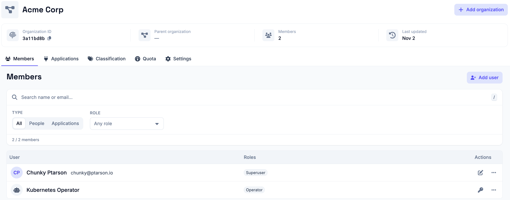

# Managing Users

Users represent identities that can access Plakar Control Plane. They are used
either by people interacting with the web interface or by applications
authenticating to the API. Plakar Control Plane supports two types of users:

- **[Member](members)**: a person who signs in to the web interface and
  interacts with Plakar Control Plane.
- **[Application](applications)**: a non-human identity used by software to
  authenticate to the Plakar Control Plane API using an API key.

## Creating users

You can create either a **Member** or **Application** user depending on how the
identity will access Plakar Control Plane.

A user exists once in the deployment, but works in an organization only as a
member of it. Membership is what allows a user to sign in to an organization and
reach its inventories, apps and other objects. What the user can do with them
depends on the roles granted in that organization, as described below.

Users are identified by their email address, and that identity is shared across
the entire Plakar Control Plane deployment. You add a user to an organization by
providing a name and an email address, and the result depends on whether that
email address is already known:

- If no user with that email address exists, the user is created and added as a
  member of the organization.
- If a user with that email address already exists, that user is added as a
  member of the organization. No new user is created, and the existing
  credentials remain unchanged.

Permissions are scoped to an organization as well. A user who belongs to several
organizations holds a separate set of roles in each one, so the same person can
have full administrative access in one organization and limited access in
another. Nothing granted in one organization carries over to another.

See [permissions](../permissions) for what each role grants, and
[members](../organizations#members) for how you grant and revoke roles.

## Removing users from an organization

Removing a user from an organization revokes their access to that organization
and its resources. Because a user identity is shared across the deployment, the
user itself is not deleted and their memberships in other organizations are
unaffected.

A user who has been removed from every organization remains in Plakar Control
Plane but cannot sign in, because they no longer have access to anything. The
account becomes usable again once the user is added to an organization, and the
existing credentials continue to work.

Roles are not retained when a user is removed. A user who is added back to an
organization starts with no permissions again, exactly like a newly created
user, and must be granted the roles they need.

## User roles

A user's access is determined by the role assigned to them within each
organization. Because roles are scoped to an organization, the same user may
hold a different one in each organization they belong to. A user might
administer the **AWS** organization while only being able to run backups in the
**VMware** organization.

Roles apply to application users in the same way they apply to member users. An
application user with no role assigned can authenticate with its API key but
cannot do anything with it. See [permissions](../permissions) for the roles that
can be assigned and exactly what each of them reaches.

## [Member Users](https://www.plakar.io/docs/control-plane/access-control/users/members/index.md)

## [Application Users](https://www.plakar.io/docs/control-plane/access-control/users/applications/index.md)

