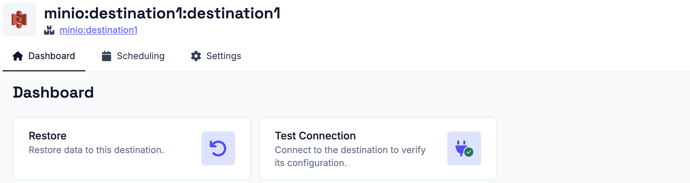

# Destination App

A destination app is where a restore writes data. It can be the resource the
data was backed up from, or another resource, for example to recover into a test
environment.

## Creating a destination app

A destination app is created from the **Apps** tab of the resource, with
**Assign App** and the **Destination** type. It has no settings of its own
beyond the integration and its configuration, which work as for every app, as
described in [setting up an app](../apps#setting-up-an-app).

## Restoring

The **Dashboard** tab of the app restores a backup to the destination with
**Restore Backup**, once a store with restore points is available. See
[testing the connection](../apps#testing-the-connection) and
[tasks](../apps#tasks).

