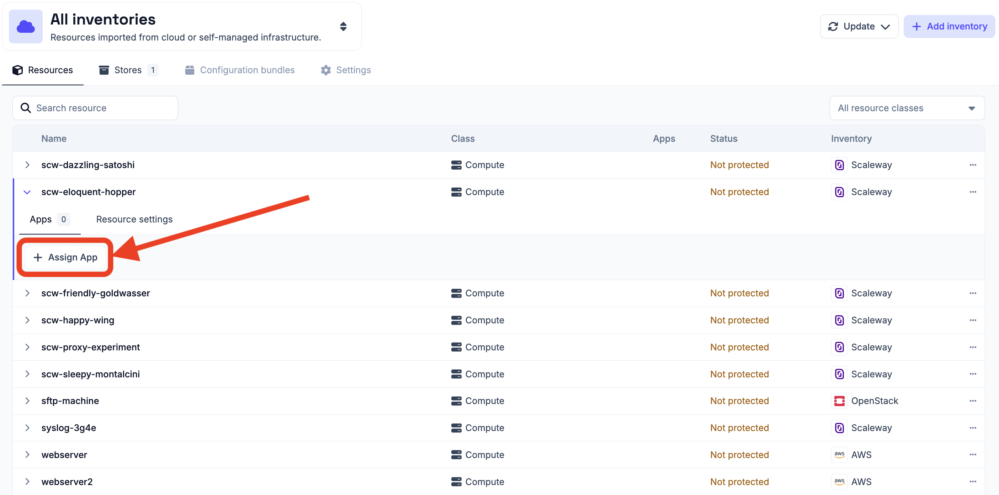
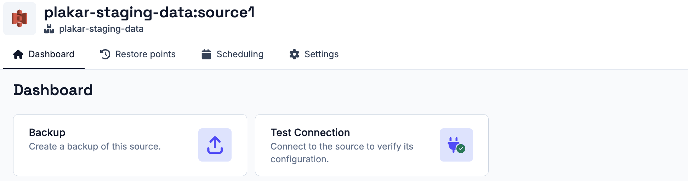
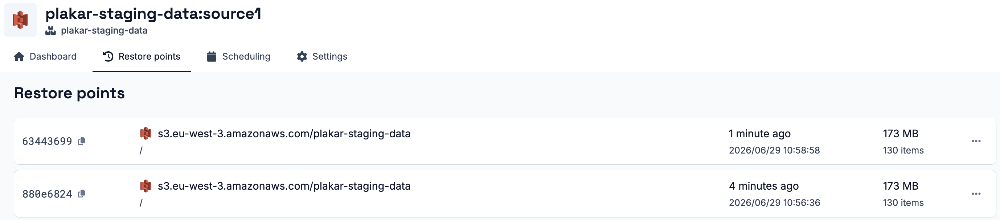

# Source App

A source app is the resource being protected, such as a database, a virtual
machine or a bucket. Each backup reads the data of the resource and writes it to
a store as a new restore point.

## Creating a source app

A source app is created from the **Apps** tab of the resource, with **Assign
App** and the **Source** type. The integration, its configuration and the way
fields are filled work as for every app, as described in
[setting up an app](../apps#setting-up-an-app).

A source app also has an **Environment** and one or more **Data Classes**:

- **Environment**: the environment of the resource, such as production,
  development or testing.
- **Data Class**: the kind of data the resource holds, such as critical,
  database, financial records or PII.

When the resource carries
[environment and data class tags](../../resources#environment-and-data-class-tags),
both are filled in from them and can still be changed. The policies engine uses
them to decide which [policies](../../compliance/policies) apply to the source.

## Backing up

The **Dashboard** tab of the app creates a backup task from the source with
**Create Backup**, once a store is available to back up to. See
[testing the connection](../apps#testing-the-connection) and
[tasks](../apps#tasks).

## Restore points

The **Restore points** tab lists the restore points available for the source. A
restore point can be opened to view its files and download individual files
without a full restore. It can also be downloaded whole,
[checked](../../scheduling/tasks/#check-task), or placed under a
[legal hold](../compliance/legal-hold).

