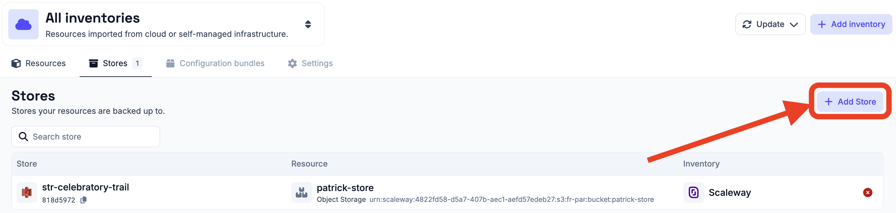
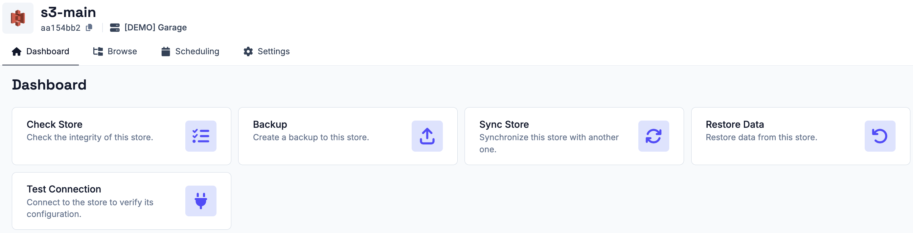
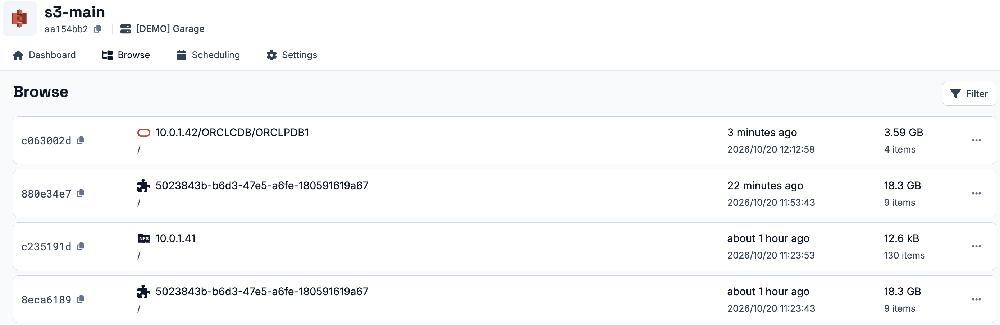

# Store App

A store app is where backups are kept. Its resource, such as an S3 bucket or an
SFTP server, holds a Kloset store, an encrypted and deduplicated repository of
restore points. Backups write new restore points to the store, restores and
syncs read them back, and checks verify their integrity.

## Creating a store app

Store apps are created from the **Stores** tab of an inventory, by selecting the
resource that holds the store. The integration, its configuration and the way
fields are filled work as for every app, as described in
[setting up an app](../apps#setting-up-an-app).

A store app also has a **Storage Type**:

- **Standard**: the store is available at all times.
- **Cold**: the store uses archival storage, such as Amazon S3 Glacier, where
  data must be retrieved before it can be read.

The storage type tells the policies engine how the store behaves. It does not
change the underlying storage. For S3, archival storage is configured through
the storage class of the store, as described in
[Cold Storage on Amazon S3 Glacier](../../resources/object-storage/s3#cold-storage-on-amazon-s3-glacier).

## Testing and initializing

A store app only describes where backups go. The Kloset store itself is a
structure that must exist at that location before anything can be written to it.

**Test Connection**, on the **Dashboard** tab of the app, checks that Plakar
Control Plane can reach the location and reports whether a Kloset store is
already there. A location that has held a store before is recognized and needs
no further preparation.

A location that has never held a Kloset store, such as a new S3 bucket, must be
initialized before it can receive backups. Initializing writes the store
configuration to the location and leaves an empty store. It happens once per
location and is not destructive. Initializing a location that already holds a
store fails and leaves that store untouched.

Backups are compressed as they are written to the store, with an algorithm
chosen at initialization. `LZ4` is the default. `GZIP` or `ZSTD` can be selected
in the advanced settings of the initialization dialog.



Once the store is initialized, its dashboard creates the tasks that act on it:

- **Check Store**: checks the integrity of the store.
- **Create Backup**: backs up a source to the store.
- **Sync Store**: synchronizes the store with another store.
- **Restore Data**: restores from the store to a destination.

## Browsing restore points

The **Browse** tab lists the restore points held in the store. A restore point
can be opened to view its files and download individual files without a full
restore. It can also be downloaded whole,
[checked](../../scheduling/tasks/#check-task), or placed under a
[legal hold](../compliance/legal-hold).

