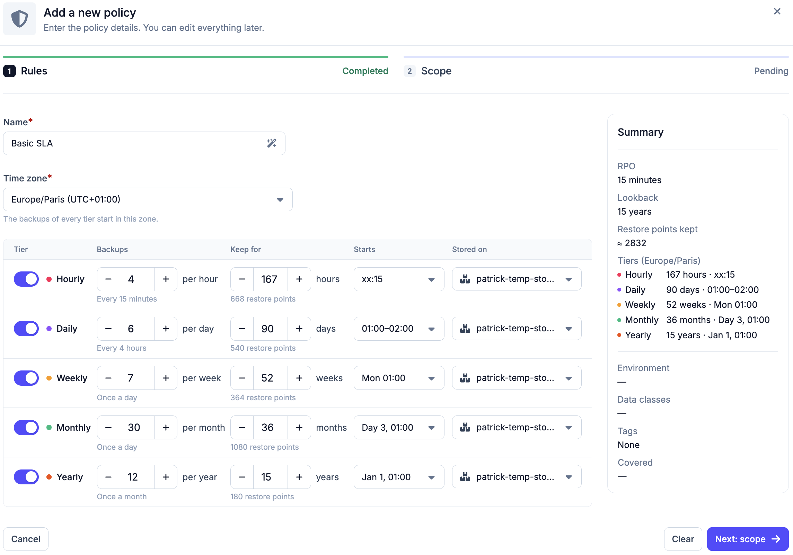
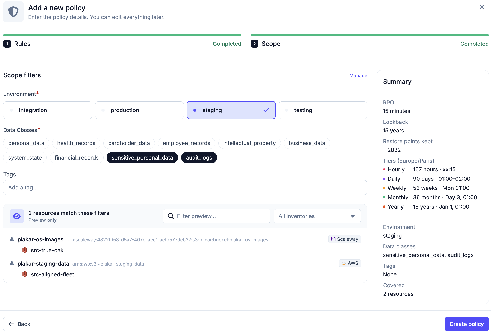
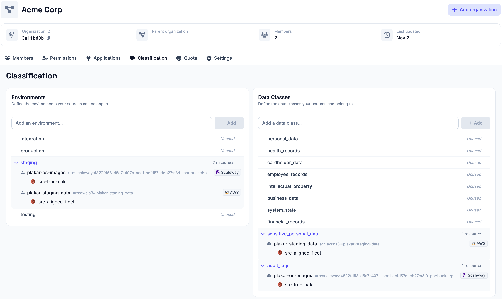

# SLA Policies

An SLA policy defines backup requirements for your sources i.e. how often
backups should be taken and how long they should be retained. When a policy is
scoped to an environment and data class, Plakar Control Plane automatically
creates backup schedules for all source apps that match.

<!-- prettier-ignore-start -->

flowchart TD
  subgraph Policy["SLA Policy"]
    Requirements["Frequency & retention"]
    Scope["Scope\n(environment, data class, tag)"]
    PolicyStore["Store app"]
  end

  subgraph Sources["Source Apps"]
    S1["Source A\nproduction · database"]
    S2["Source B\nproduction · critical"]
    S3["Source C\nstaging · database"]
  end

  Scope -->|"auto-match"| S1 & S2
  S1 & S2 -->|"schedule created"| Backup["Backup"]
  Requirements --> Backup
  Backup --> PolicyStore

<!-- prettier-ignore-end -->

Policies belong to a single organization. You work only with the policies of the
organization you signed in to, and what you can do with them is determined by
the [permissions](../../access-control/permissions) you hold there.

## Creating a policy

A policy is created in two steps, its rules and then its scope. It needs a name,
at least one retention tier with a store, an environment and at least one data
class. Everything can then be changed later.

### Rules

The rules define how often backups are taken, how long they are kept and where
they are stored. They are set per retention tier:

- Hourly
- Daily
- Weekly
- Monthly
- Yearly

Any combination of tiers can be enabled. For each tier, you configure:

- **Backups:** how many backups are taken within the period of the tier, for
  example 3 an hour, which is one every 20 minutes.
- **Keep for:** how long the restore points of the tier are kept, for example 7
  days.
- **Starts:** when the backups of the tier start. See
  [Start time and window](#start-time-and-window).
- **Stored on:** the [store](../../apps/stores) the backups of the tier are
  written to. Each tier can use a different store.

### Start time and window

Each tier has a start, and the policy has one time zone that applies to every
tier. Starts follow the local clock of that zone, so a daily backup at 02:00 in
`Europe/Paris` runs at 02:00 Paris time in both summer and winter.

The Hourly tier starts at a minute past the hour, such as `xx:30`. The other
tiers start at a time of day. The Weekly tier also sets a day of the week, the
Monthly tier a day of the month, and the Yearly tier a month and a day. A month
without the chosen day, such as the 31st, runs on its last day. When a tier
takes several backups in its period, they are evenly spaced from the start. For
example, 4 backups a day starting at 01:00 run at 01:00, 07:00, 13:00 and 19:00.

A tier other than Hourly can start within a window, such as 02:00 to 06:00,
instead of at a single time. Each source then gets its own start time inside the
window and keeps it from one run to the next, so the sources of a policy do not
all start against the same stores at once. Adding a source does not move the
others. Changing the window gives every source a new time. A window can cross
midnight, but it must be shorter than 24 hours and than the time between two
backups of the tier. A Daily tier with 4 backups a day runs every 6 hours, so
its window must be shorter than 6 hours.

When the clocks go forward, a start time that does not exist, such as 02:30,
runs an hour later. When the clocks go back, a start time that occurs twice runs
the first time.

Policies created before start times were available keep the hour they already
run at until the start of a tier is changed.

### Scope

The scope selects the source apps the policy applies to:

- **Environment:** required.
- **Data classes:** required. One or more.
- **Tags:** optional. Narrows the match to sources whose resource carries at
  least one of the listed tags.

Environments and data classes are managed in the organization's
[classification settings](#managing-environments--data-classes). A preview lists
the resources and source apps the scope matches before the policy is created.

A matched source is only scheduled when it and its store share the same
[data residency](./residency).

Scopes can overlap, for example a general policy for all production sources and
a stricter one for production databases. A source app matched by several
policies follows the one with the lowest RPO.

### Summary

The policy shows a summary of the contract it defines. The RPO is the maximum
data loss window, based on the most frequent backup. The lookback is how far
back data can be restored, based on the longest retention. The summary also
shows the approximate number of restore points kept and how many resources the
scope covers.

## Scheduling

The [policy scheduler](../../scheduling/policy-scheduler) creates a backup
schedule for every source app the policy matches, using the store and start of
each tier.

A policy selects source apps by classification, not by name, so it also covers
source apps created later. When an [inventory](../../inventories) discovers a
resource, a
[configuration bundle](../../inventories/configuration-bundles#auto-creating-apps)
can create its source app, which takes its environment and data class from the
tags of the resource. Plakar Control Plane re-evaluates the matches of each
policy every 15 minutes, so a new source app is scheduled within that time. A
source app that no longer matches any policy loses its policy schedules the same
way. See [Automating backups](../../guides/automated-backups) for the full
setup.

## Managing environments & data classes

Environments and data classes used by the SLA system to scope resources are
managed per organization, from **Organization -> Classification**. From there,
you can create new environments and data classes, or delete existing ones.

Because they belong to an organization, the environments and data classes
available to a policy are the ones defined in the organization that policy lives
in. See [Managing Organizations](../../access-control/organizations) for more
information about how organizations isolate configuration.

