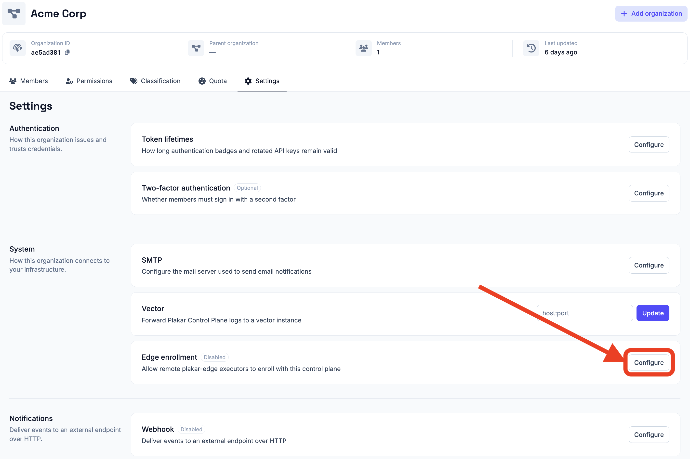

# Edge Enrollment

Before an edge can join an organization, **edge enrollment** must be enabled for
that organization. Edge enrollment is disabled by default on Control Plane.

New edges authenticate using an enrollment key generated by the Control Plane.
The key is used when an edge connects to PCP for the first time and exchanges it
for an authentication token.

You work with the edges available to the organization you signed in to, and what
you can do with them is determined by the
[permissions](../../access-control/permissions) your application user has on the
organization.

## Enabling edge enrollment

To enable enrollment, open the organization's settings and enable **Edge
enrollment** under **Organizations -> Settings**. Enable it for the organization
where the new edge should be registered.

Keep enrollment enabled while you are adding edges. Once an edge has
successfully enrolled, it no longer depends on the enrollment setting. PCP has
issued it an authentication token, which the edge stores locally and uses for
subsequent connections.

You can therefore **disable edge enrollment after you have finished registering
your edges**. Disabling enrollment prevents new edges from joining the
organization, but does not affect edges that are already enrolled.

If you need to add another edge later, enable enrollment again before starting
its first connection to PCP. You can regenerate the enrollment key at any time.
If you regenerate it, use the new key when enrolling subsequent edges.

## Sharing edges with child organizations

An organization shares its edges with the organizations below it by handing down
its edge enrollment setting. Every organization that inherits the setting, at
any depth, can use the edges of the organization that set it. The setting is
inherited like any other organization setting, as described in
[handing settings down](../../access-control/organization-settings#handing-settings-down).

A shared edge runs tasks like one of the organization's own. It appears in the
organization's list of edges, tasks can be pinned to it, and PCP can pick it
when it [selects an edge](../running-tasks#selecting-an-edge) for a task. Only
the organization that enrolled the edge can manage it.

An organization gets edges from one organization above it at most: the one it
inherits the edge enrollment setting from. For example, the root organization
hands the setting down, and organization A below it sets its own and hands that
down too. Organization B below A then uses A's edges along with its own, but not
the root organization's.

The edges are shared for as long as the setting is inherited, whether or not
enrollment is enabled in it. Disabling enrollment only stops new edges from
joining.

An edge joins the organization that owns the enrollment key it presents. An edge
enrolled with an inherited key therefore joins the organization that handed the
setting down, even when it was set up for an organization below. An organization
enrolls edges of its own by setting its own edge enrollment value. A locked
setting prevents this, so the organizations below share the edges of the
organization that locked it and cannot enroll any of their own.

