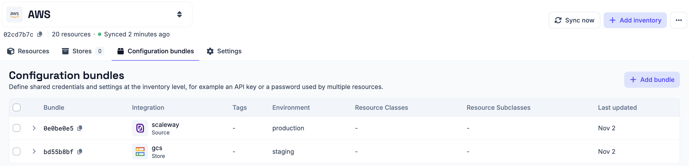
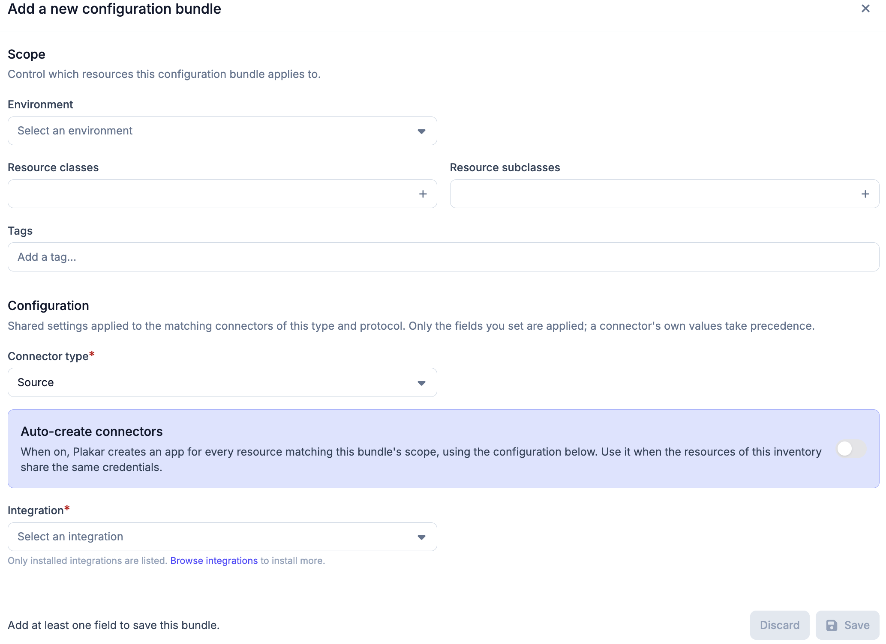
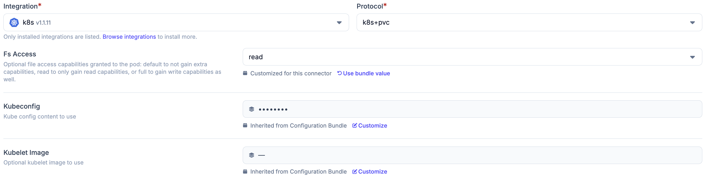

# Configuration Bundles

Configuration bundles are defined on an inventory and declare configuration
fields, such as credentials, for the resources of that inventory. When an app is
set up on one of those resources, the fields declared in the bundle are applied
to it, so they do not have to be entered again for every app.

For example, an AWS inventory might discover 20 S3 buckets that all use the same
access key and secret key. A single bundle on that inventory, scoped to the
`Object Storage` class, declares those credentials once, and every app set up on
one of the buckets receives them.

A bundle applies only to resources of the inventory it belongs to. Bundles are
managed from the **Configuration bundles** tab of the inventory, and what can be
done with them depends on the [permissions](../../access-control/permissions)
held in the organization the inventory belongs to.

## Matching resources

The scope of a bundle determines which resources of the inventory it applies to.
Without any filter, a bundle applies to every resource. Each filter narrows the
scope, and a resource must match all of them to receive the bundle:

- **Environment**: resources in the selected environment. With **Any
  environment** selected, the environment does not narrow the scope.
- **Resource classes**: resources of one of the selected classes, such as
  `Database` or `Object Storage`.
- **Resource subclasses**: resources of one of the selected subclasses, such as
  `MySQL` or `S3`, within the selected classes.
- **Tags**: resources that carry every listed tag. Managed inventories discover
  tags from the provider. Self-managed inventories take them from the resource
  definition, as described in
  [adding resources](../self-managed/#adding-resources).

The class filter matters most for bundles that
[auto-create apps](#auto-creating-apps). An inventory usually holds resources of
several classes. An AWS inventory, for example, discovers both S3 buckets and
EC2 instances. A bundle for the S3 integration with no class filter applies to
every resource of the inventory, so it creates S3 apps for the EC2 instances
too. Scoping it to the `Object Storage` class limits it to the buckets.

## Bundle fields

A bundle targets one kind of app, set by its **Connector type**: `Source`,
`Store` or `Destination`. It also targets one integration and, when the
integration has several, one protocol. Only installed integrations can be
selected. The bundle applies to apps of that type, integration and protocol on
the resources in its scope.

The fields of a bundle are chosen from the fields of the selected integration
and protocol, either one at a time or all at once. A bundle only sets the fields
it contains. Every other field is left as each app defines it, and a value set
on the app itself takes precedence over the bundle.

The form marks the fields the integration requires. A bundle does not have to
contain them. A partial bundle, for example one that only holds credentials, is
saved like any other. The fields it leaves out are entered on each app, and it
cannot [auto-create apps](#auto-creating-apps).

## Applying a bundle to apps

When a source, store or destination app is set up on a resource in the scope of
a bundle, the fields of the bundle are filled in, and the form shows which
fields come from the bundle. Only the remaining fields need to be entered. If
the bundle provides every required field, the app is created without further
input.

A field provided by a bundle can be overridden for a single app by entering
another value. The override applies only to that app. The bundle and the other
apps it applies to are unaffected.

See the [apps](../../apps) documentation for how apps are set up on resources.

## Auto-creating apps

A source or destination bundle can also create apps itself. Store bundles
cannot. Their fields are only applied to store apps set up by hand.

With **Auto-create connectors** enabled, Plakar Control Plane creates an app for
every resource in the scope of the bundle, using the configuration of the
bundle. Apps are only created when the
bundle supplies every field the integration requires. A bundle that leaves a
required field empty creates no apps, and each app has to be set up by hand.

Auto-creation suits inventories whose resources share the same credentials,
where a single bundle can hold the complete configuration. Scope such a bundle
with a [class filter](#matching-resources), so it only creates apps on the
resources its integration can protect.

