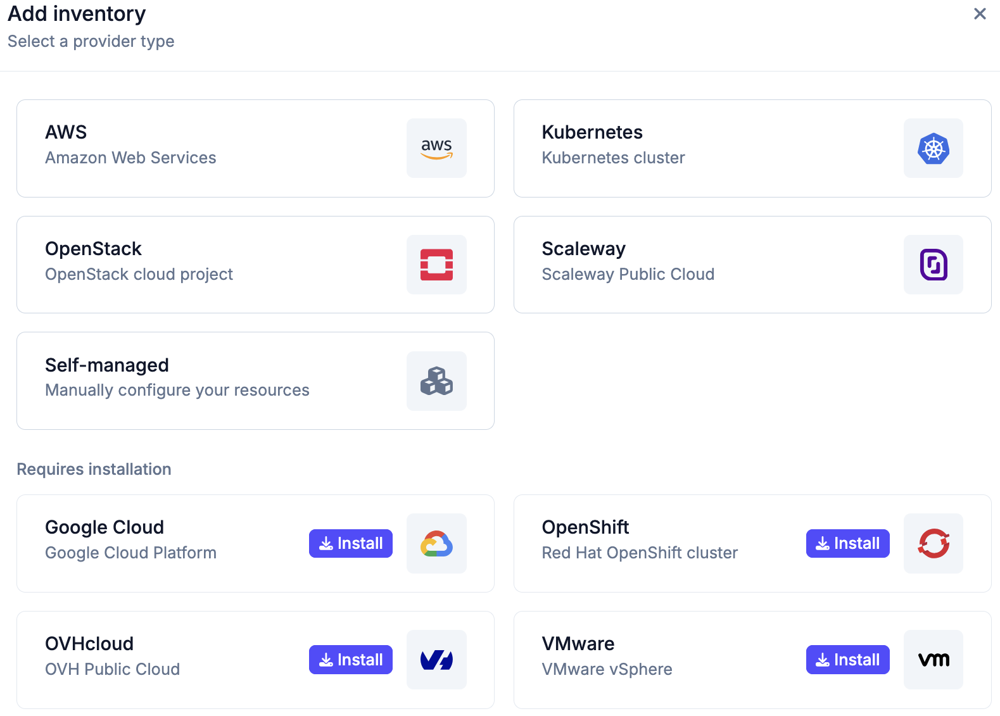

# Inventories

An inventory holds the resources that Plakar Control Plane can manage. A
resource is an individual entity that can be backed up, used as storage, or
restored to, such as an EC2 instance or an S3 bucket. A managed inventory
discovers its resources from a provider, while a self-managed inventory holds
resources defined by hand.

Each inventory belongs to one organization. Only the inventories of the
organization you are signed in to are visible, and the
[permissions](../access-control/permissions) held in that organization determine
what can be done with them.

Inventory providers are delivered as integrations, so a provider must be
installed before an inventory can use it. Providers can be installed from the
**Integrations** page or from the **Add inventory** dialog, which lists
installed providers alongside those available to install.

## Managed inventories

A managed inventory connects to a provider with credentials and discovers the
resources of the account, classified by type. The provider is the source of
truth. Resources cannot be created or deleted by hand in a managed inventory,
and changes made in the provider appear at the next synchronization.

## Inventory Synchronization

Plakar Control Plane synchronizes a managed inventory in the background, listing
the resources of the provider again on a fixed period. The period is set per
inventory, in the **Synchronization** section of its settings, and defaults to
900 seconds, or 15 minutes. The minimum is 30 seconds. A shorter period picks up
new resources sooner, at the cost of more calls to the provider API. A
synchronization can also be started at any time with **Sync now**, without
waiting for the next period.

## Self-managed inventories

A self-managed inventory holds resources that are added by hand, one at a time
or in bulk from a CSV file. It covers infrastructure that no managed inventory
discovers, such as a local MinIO instance or a self-hosted database.

## Resources

An inventory exposes its resources, each with a class, subclass, tags, and the
endpoints and attributes that identify where it is reached. A managed inventory
discovers them from the provider, and they cannot be edited. In a self-managed
inventory, they are entered with the resource. See
[Resource Types](../resources) for what a resource carries and how it is used,
and [Filtering resources](../resources#filtering-resources) for narrowing the
list.

A new inventory has no resources yet. A managed inventory that has never been
synchronized offers **Sync now**, which starts its first
[synchronization](#inventory-synchronization). A self-managed inventory with no
resources offers **Add resource**, described in
[Adding resources](self-managed#adding-resources). Both actions are unavailable
without the [permission](../access-control/permissions) to change the resources
of the inventory.

## Data residency

An inventory can have a **residency**, which is inherited by every resource it
exposes. This gives those resources a country in which their data must remain. A
residency set on an individual resource takes precedence over the inherited one.
See [Residency](../resources#residency) for how it restricts the resources that
can be used together.

## Edge pools

An inventory can name an [edge pool](../edges/running-tasks#selecting-an-edge),
which is inherited by every resource it exposes. Tasks that use those resources
run on an edge of the pool instead of on the Control Plane. A pool set on an
individual resource takes precedence over the one inherited from the inventory.

The inventory itself is also synchronized through the pool. An edge of the pool
lists the resources from the provider and sends the results back to PCP. This
lets an inventory cover resources the Control Plane cannot reach directly, such
as resources behind a private network, as long as an edge of the pool can reach
them. When no edge of the pool is available, the synchronization fails rather
than running on the Control Plane.

## Configuration bundles

Configuration bundles declare shared fields, such as credentials, that are
filled in when an app is set up on a matching resource of the inventory. See
[configuration bundles](configuration-bundles) for details.

## [Managed Inventories](https://www.plakar.io/docs/control-plane/inventories/managed/index.md)

- [AWS](https://www.plakar.io/docs/control-plane/inventories/managed/aws/index.md): How to connect and manage AWS inventory in Plakar Control Plane.
- [OVHcloud](https://www.plakar.io/docs/control-plane/inventories/managed/ovhcloud/index.md): How to connect and manage OVHcloud inventory in Plakar Control Plane.
- [Scaleway](https://www.plakar.io/docs/control-plane/inventories/managed/scaleway/index.md): How to connect and manage Scaleway inventory in Plakar Control Plane.
- [Google Cloud](https://www.plakar.io/docs/control-plane/inventories/managed/google-cloud/index.md): How to connect and manage Google Cloud inventory in Plakar Control Plane.
- [Kubernetes](https://www.plakar.io/docs/control-plane/inventories/managed/kubernetes/index.md): How to connect and manage Kubernetes inventory in Plakar Control Plane.
- [VMware](https://www.plakar.io/docs/control-plane/inventories/managed/vmware/index.md): Connect and manage a VMware inventory in Plakar Control Plane.
- [OpenStack](https://www.plakar.io/docs/control-plane/inventories/managed/openstack/index.md): How to connect and manage OpenStack inventory in Plakar Control Plane.
- [OpenShift](https://www.plakar.io/docs/control-plane/inventories/managed/openshift/index.md): How to connect and manage an OpenShift inventory in Plakar Control Plane.

## [Self-Managed Inventories](https://www.plakar.io/docs/control-plane/inventories/self-managed/index.md)

## [Configuration Bundles](https://www.plakar.io/docs/control-plane/inventories/configuration-bundles/index.md)

