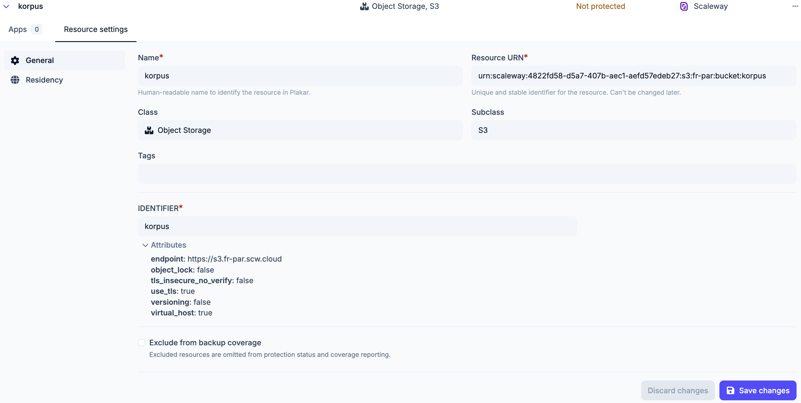

# Inventories

An inventory holds the resources that Plakar Control Plane can manage. A
resource is an individual entity that can be backed up, used as storage, or
restored to, such as an EC2 instance or an S3 bucket. A managed inventory
discovers its resources from a provider, while a self-managed inventory holds
resources defined by hand.

Each inventory belongs to one organization. Only the inventories of the
organization you are signed in to are visible, and the
[permissions](../access-control/permissions) held in that organization determine
what can be done with them.

Inventory providers are delivered as integrations, so a provider must be
installed before an inventory can use it. Providers can be installed from the
**Integrations** page or from the **Add inventory** dialog, which lists
installed providers alongside those available to install.

## Managed inventories

A managed inventory connects to a provider with credentials and discovers the
resources of the account, classified by type. The provider is the source of
truth. Resources cannot be created or deleted by hand in a managed inventory,
and changes made in the provider appear at the next synchronization.

## Self-managed inventories

A self-managed inventory holds resources that are added by hand, one at a time
or in bulk from a CSV file. It covers infrastructure that no managed inventory
discovers, such as a local MinIO instance or a self-hosted database.

## Resources

A resource is identified by its resource URN, which cannot change once the
resource exists. It also has a name, a class, subclass and tags.
[Configuration bundles](configuration-bundles) select resources by class and
tags, and [policies](../compliance/policies) can narrow their scope by tag. In a
managed inventory, the class and tags are discovered from the provider and
cannot be edited.

Each resource also has one or more endpoints that identify where it is reached,
such as a hostname, an IP address or a bucket name. In a self-managed inventory,
the endpoints are entered with the resource. In a managed inventory, they are
discovered from the provider, together with attributes that describe the
resource, such as the S3 endpoint of a bucket or whether versioning is enabled
on it. When an app is set up on the resource, the endpoints and attributes fill
in the matching fields, so they do not have to be entered again.

Backups and restores are configured by setting up [apps](../apps) on a resource.
There are three types of app:

- **Source**: the resource is backed up.
- **Store**: the resource holds backups.
- **Destination**: data is restored to the resource.

Each resource has a protection status, which reflects whether it is covered by
backups. A resource that does not need backups, such as a test database or a
temporary bucket, can be excluded from backup coverage. An excluded resource is
left out of protection status and coverage reporting.

## Data residency

An inventory can have a **residency**, which is inherited by every resource it
exposes. This gives those resources a country in which their data must remain. A
residency set on an individual resource takes precedence over the inherited one,
for a resource located in a different country from the rest of the inventory.

When you configure an operation, PCP only allows resources with the same
residency to be used together. For example, resources from an inventory with a
French residency can only be backed up to, restored from, or synchronized with
resources that also have a French residency. See
[data residency](../compliance/residency) for more information.

## Configuration bundles

Configuration bundles declare shared fields, such as credentials, that are
filled in when an app is set up on a matching resource of the inventory. See
[configuration bundles](configuration-bundles) for details.

## [Managed Inventories](https://www.plakar.io/docs/control-plane/inventories/managed/index.md)

- [AWS](https://www.plakar.io/docs/control-plane/inventories/managed/aws/index.md): How to connect and manage AWS inventory in Plakar Control Plane.
- [OVHcloud](https://www.plakar.io/docs/control-plane/inventories/managed/ovhcloud/index.md): How to connect and manage OVHcloud inventory in Plakar Control Plane.
- [Scaleway](https://www.plakar.io/docs/control-plane/inventories/managed/scaleway/index.md): How to connect and manage Scaleway inventory in Plakar Control Plane.
- [Google Cloud](https://www.plakar.io/docs/control-plane/inventories/managed/google-cloud/index.md): How to connect and manage Google Cloud inventory in Plakar Control Plane.
- [Kubernetes](https://www.plakar.io/docs/control-plane/inventories/managed/kubernetes/index.md): How to connect and manage Kubernetes inventory in Plakar Control Plane.
- [VMware](https://www.plakar.io/docs/control-plane/inventories/managed/vmware/index.md): Connect and manage a VMware inventory in Plakar Control Plane.
- [OpenStack](https://www.plakar.io/docs/control-plane/inventories/managed/openstack/index.md): How to connect and manage OpenStack inventory in Plakar Control Plane.

## [Self-Managed Inventories](https://www.plakar.io/docs/control-plane/inventories/self-managed/index.md)

## [Configuration Bundles](https://www.plakar.io/docs/control-plane/inventories/configuration-bundles/index.md)

