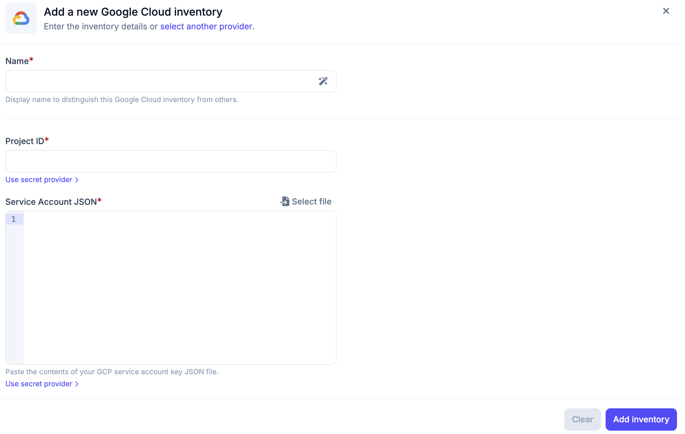

# Google Cloud Inventory

The Google Cloud inventory allows Plakar Control Plane to connect to your Google
Cloud project and discover resources within it. Once connected, Plakar Control
Plane discovers supported Google Cloud resources and makes them available for
management directly within Plakar Control Plane.

## Supported Resources

| Resource         | Source | Store | Destination |
| ---------------- | ------ | ----- | ----------- |
| Cloud Storage    | Yes    | Yes   | Yes         |
| CloudSQL (MySQL) | Yes    | No    | Yes         |

## Authentication

Google Cloud inventories authenticate as a service account. The service account
must have a custom IAM role with the permissions required to discover resources
in the Google Cloud project you want to inventory.

A Google Cloud inventory needs a name, the **Project ID** of the Google Cloud
project to discover, and a **Service account key** (JSON), pasted directly or
uploaded as a file. The key can be left empty when Plakar Control Plane runs on
a Compute Engine instance with an attached service account. The inventory then
uses the instance's service account automatically. The instance must use the
`cloud-platform` access scope, shown as **Allow full access to all Cloud APIs**
in the Google Cloud Console, as described in the
[Google Cloud installation](../../../intro/installation/google-cloud) guide.

For more information on creating custom IAM roles and service accounts, see
[Managing IAM Roles and Service Accounts](../../../guides/google-cloud/iam-roles-and-service-accounts).

## Required Permissions

Plakar Control Plane requires read access to Google Cloud resources so it can
discover and classify them during inventory synchronization.

The custom IAM role assigned to the service account, whether it is provided as a
key or attached to the instance, must include the following permissions:

| Permission                             | Description                                   |
| -------------------------------------- | --------------------------------------------- |
| `cloudasset.assets.searchAllResources` | Searches for resources across the project     |
| `cloudsql.instances.get`               | Retrieves details of a CloudSQL instance      |
| `cloudsql.instances.list`              | Lists CloudSQL instances in the project       |
| `storage.buckets.get`                  | Retrieves metadata for a Cloud Storage bucket |
| `storage.buckets.list`                 | Lists Cloud Storage buckets in the project    |

## Creating a Google Cloud Inventory

When creating a new Google Cloud inventory, provide the inventory name, the
project ID and, unless the instance has an attached service account, the service
account key. The key is either pasted into the field as JSON or loaded from a
key file.

After creating the inventory, trigger a synchronization to discover and load
resources from the configured Google Cloud project. You can run synchronization
again at any time to refresh the inventory, for example after creating new Cloud
Storage buckets or CloudSQL instances.

