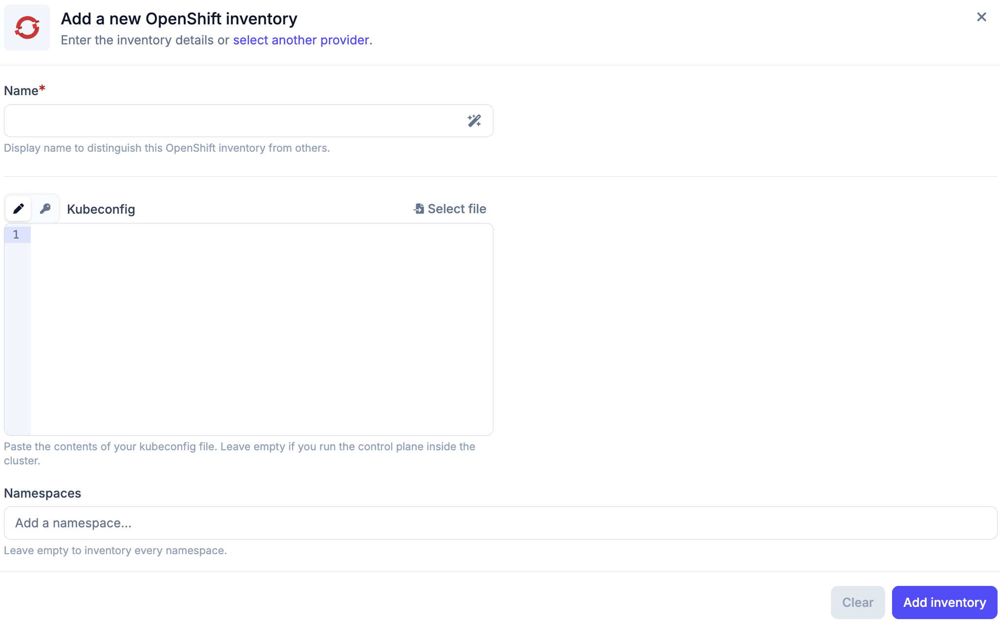

# OpenShift Inventory

The OpenShift inventory lets Plakar Control Plane connect to an OpenShift
cluster and discover its namespaces, its PersistentVolumeClaims and its
OpenShift Virtualization virtual machines. Once connected, the discovered
resources become available for management directly from Plakar Control Plane.

## Supported Resources

| Resource                                                                          | Source | Store | Destination |
| --------------------------------------------------------------------------------- | ------ | ----- | ----------- |
| [Cluster and namespaces](../../resources/compute/openshift/cluster)               | Yes    | No    | Yes         |
| [PersistentVolumeClaims (PVC)](../../resources/block-storage/openshift-pvc)       | Yes    | No    | Yes         |
| [OpenShift Virtualization virtual machines](../../resources/compute/openshift/vm) | Yes    | No    | Yes         |

The cluster and namespace resources hold the manifests of the cluster. When the
inventory discovers every namespace, it also lists a `cluster` resource that
covers the whole cluster. Each namespace it discovers is listed as a resource of
its own, named after the namespace.

Virtual machines are discovered only when OpenShift Virtualization is installed
in the cluster.

## Authentication

OpenShift inventories authenticate with a kubeconfig. The kubeconfig determines
which cluster Plakar Control Plane connects to and which permissions it has, so
the associated user or service account must be able to read the namespaces,
PersistentVolumeClaims and virtual machines you want to discover. The kubeconfig
can be left empty when Plakar Control Plane runs inside the cluster, in which
case it uses the in-cluster credentials. The roles in
[Kubernetes Service Accounts and RBAC](../../../guides/kubernetes/kubernetes-rbac#inventory)
apply to OpenShift as well, and give the inventory least-privilege access.

## Creating an OpenShift Inventory

An OpenShift inventory needs a name and, unless Plakar Control Plane runs inside
the cluster, the contents of a kubeconfig. The kubeconfig can be pasted directly
or loaded from a [secret provider](../../secret-providers). Optionally, provide
a comma-separated list of namespaces to limit discovery to those namespaces.
Left empty, the inventory discovers every namespace.

An inventory discovers its resources when it is synchronized, so a new inventory
is empty until its first synchronization. Synchronizing again refreshes the
inventory, for example after namespaces, PVCs or virtual machines are added to
the cluster.

