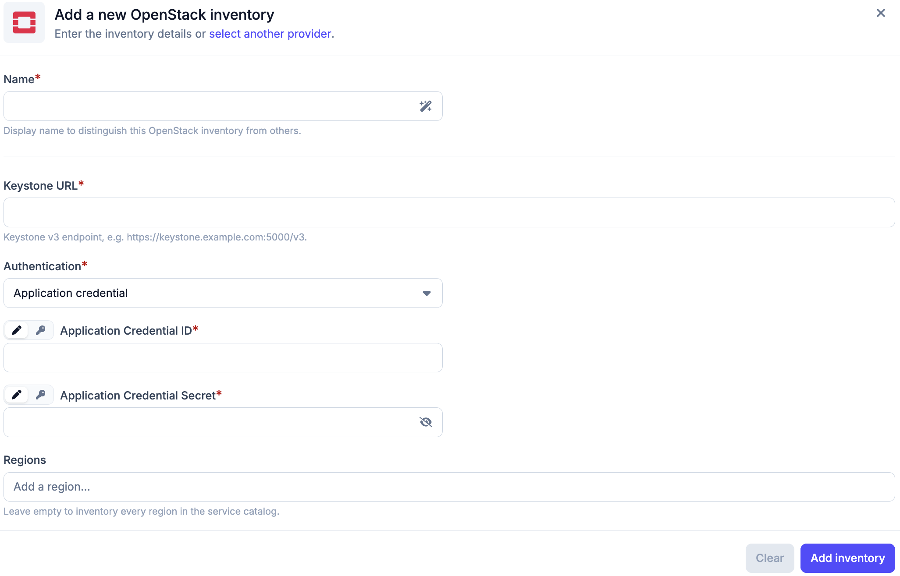

# OpenStack Inventory

The OpenStack inventory allows Plakar Control Plane to connect to an OpenStack
cloud and discover resources in a single OpenStack project. Once connected,
Plakar Control Plane discovers supported resources in every region the
credentials can reach and makes them available for management directly within
Plakar Control Plane.

## Discovery flow

<!-- prettier-ignore-start -->

flowchart TD
  subgraph Plakar["Plakar Control Plane"]
    Inventory["OpenStack Inventory Discover & classify"]
  end

  subgraph Creds["Authentication"]
    direction LR
    AppCred["Application Credential"]
    UserPass["Username + Password"]
  end

  Keystone["Keystone Service catalog"]

  subgraph OpenStack["OpenStack Project"]
    Resources["Supported Resources (every region)"]
  end

  Inventory --> AppCred & UserPass
  AppCred & UserPass -->|"authenticate"| Keystone
  Keystone -->|"OpenStack APIs"| Resources
  Resources -->|"sync to inventory"| Inventory

<!-- prettier-ignore-end -->

## Supported Resources

| Resource                          | Source | Store | Destination |
| --------------------------------- | ------ | ----- | ----------- |
| Block Storage (Cinder volumes)    | Yes    | No    | Yes         |
| Compute (Nova servers)            | Yes    | No    | Yes         |
| Object Storage (Swift containers) | No     | No    | No          |
| Images (Glance images)            | No     | No    | No          |
| Database (Trove databases)        | Yes    | No    | Yes         |

Only the Glance images owned by the project are discovered.

## Authentication

OpenStack inventories authenticate against Keystone, the OpenStack identity
service. Keystone returns the service catalog, which lists the endpoints and
regions available to the project. Two authentication methods are supported:

- **Application credential** (recommended): a credential created for a single
  project with a restricted set of roles. It can be revoked without affecting
  the user account it was created from.
- **Username and password**: the credentials of an OpenStack user. The project
  must be specified separately.

An application credential is bound to the project in which it was created, so
the inventory discovers resources in that project and no project needs to be
specified. It can only carry roles that the user creating it already holds on
the project.

With a username and password, the project to scan is identified by its ID or
name. If both are provided, the project ID takes precedence. The domain applies
to the user, and to the project when it is identified by name.

## Required Permissions

Discovery only reads the project, so the credentials need the `reader` role on
it. See
[Managing Users and Application Credentials](../../../guides/openstack/users-and-application-credentials)
for how to create a user and an application credential with that role.

Role names depend on how the OpenStack cloud is configured. The `reader` role is
one of the default Keystone roles, but some providers define their own. Consult
the documentation of the provider for the role that grants read access.

## Creating an OpenStack Inventory

An OpenStack inventory needs a **Name**, the **Keystone URL** of the Keystone v3
endpoint, for example `https://keystone.example.com:5000/v3`, and an
**Authentication** method with its credentials. Credentials can be entered
directly or loaded from a [secret provider](../../secret-providers).

With **Application credential**, the inventory takes the **Application
Credential ID** and **Application Credential Secret**. With **Username and
password**, it takes the **Username**, **Password** and **Domain**, and either a
**Project ID** or a **Project name**.

**Regions** is optional. Left empty, the inventory discovers resources in every
region listed in the Keystone service catalog. Providing one or more region
names, for example `RegionOne` or `GRA11`, limits discovery to those regions.

An inventory discovers its resources when it is synchronized, so a new inventory
is empty until its first synchronization. Synchronizing again refreshes the
inventory, for example after instances or volumes are added to the project.

