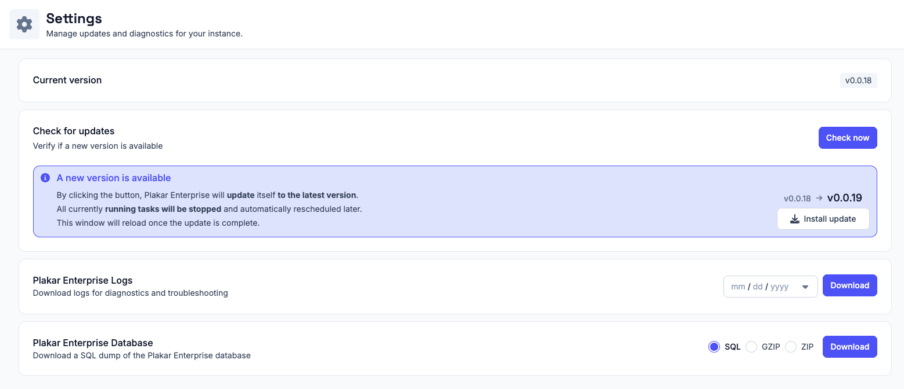
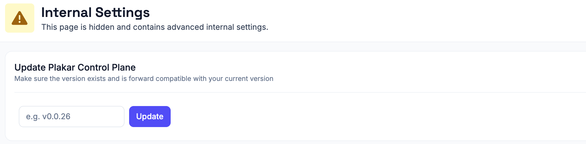

# Updating Plakar Control Plane

Plakar Control Plane updates itself in place from the web interface. The
[Control Plane settings](../control-plane-settings), under **Control Plane ->
System**, show the installed version, check whether a newer one is available,
and install it without redeploying the instance.

An update applies to the whole instance rather than to an organization. It
therefore requires the
[Platform Admin](../../access-control/permissions/platform-admin) or
[Superuser](../../access-control/permissions/superuser) role, which reach the
deployment itself. Organization roles cannot update Plakar Control Plane.

When a new version is available, the settings display an update notification
with the target version and an **Install update** action.

Installing an update stops the tasks that are running. They are rescheduled
automatically once the update is complete, and the web interface reloads.

> [!NOTE]+
>
> Most Plakar Control Plane updates only update the application itself and do
> not require changes to the underlying infrastructure or deployment
> environment.

## Updating an air-gapped Plakar Control Plane

An air-gapped instance cannot reach `plakar.io` to discover new releases, so the
update notification never appears. Updates are started instead by entering the
target version by hand, from a hidden internal settings page.

Blindly type `thisisinternal` anywhere in the web interface to open **Internal
Settings**. The page is not linked from the navigation and holds advanced
settings that are not part of normal operation. Under **Update Plakar Control
Plane**, enter the version you want to install, for example `v1.1.2`, then click
**Update**.

The version must already exist in your releases repository. Versions are tags,
and each one corresponds to a directory of the same name in that repository, so
mirror a release before entering it here. See
[hosting a package repository](../../guides/self-hosted-package-repository) for
how that repository is laid out and mirrored.

From there the update behaves as it does from the Control Plane settings.
Running tasks are stopped and rescheduled afterwards, and the web interface
reloads once the update is complete.

## Updating the underlying deployment infrastructure

Plakar Control Plane runs on AWS, OVHcloud, Scaleway and on-premises
infrastructure. Depending on the platform, it is distributed as a virtual
machine image, a cloud marketplace appliance or a container image.

Occasionally, infrastructure-level updates may also be required depending on the
deployment platform and distribution method.

For example, on AWS, Plakar Control Plane is distributed as an AMI through AWS
Marketplace. Most application updates can be installed directly from the Control
Plane settings without replacing the EC2 instance or updating the AMI.

Platform-specific infrastructure update procedures are documented separately:

## [Updating AWS AMI](https://www.plakar.io/docs/control-plane/operations/updating/aws/index.md)

## [Updating Scaleway QCOW2](https://www.plakar.io/docs/control-plane/operations/updating/scaleway/index.md)

## [Updating vSphere](https://www.plakar.io/docs/control-plane/operations/updating/vsphere/index.md)

## [Updating Proxmox ISO](https://www.plakar.io/docs/control-plane/operations/updating/proxmox/index.md)

