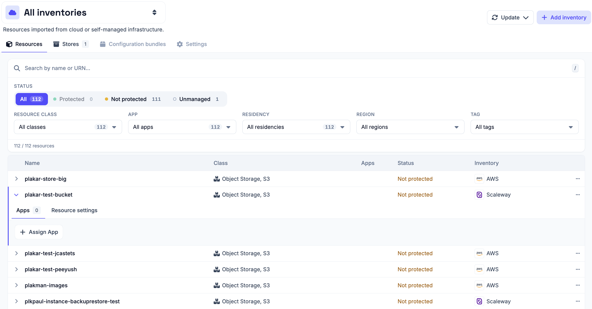
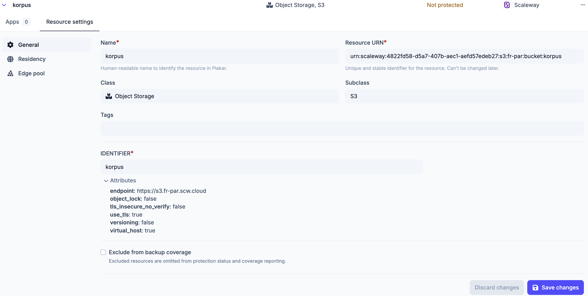

# Resource Types

Resources are the individual systems, services, or storage targets that Plakar
Control Plane manages as part of a backup workflow. Examples of resources
include S3 buckets, EC2 instances, PostgreSQL databases, virtual machines, and
filesystems.

<!-- prettier-ignore-start -->

flowchart TB
  subgraph Inventories
    Managed["Managed inventory\n(Scaleway, ...)"]
    SelfManaged["Self-managed inventory"]
  end

  subgraph Resources
    R["Resource\nclass / subclass"]
  end

  subgraph Apps
    Source["Source\n(Back up content from here)"]
    Store["Store\n(Store backups here)"]
    Destination["Destination\n(Restore here)"]
  end

  Managed -->|"auto-discover"| R
  SelfManaged -->|"manually added"| R
  R --> Source & Store & Destination

<!-- prettier-ignore-end -->

All resources discovered across all inventories are available under
**Infrastructure > Inventories**, on the **Resources** tab. From here a resource
can be assigned to either a [source](../apps/sources) or a
[destination](../apps/destinations) app. The list can be narrowed to one
inventory or filtered, as described in
[Filtering resources](#filtering-resources).

The actions on each resource include placing a
[legal hold](../compliance/legal-hold) on it. A resource under a legal hold
cannot be used by any task, so backups, restores, checks, and prunes involving
it are refused until the hold is removed.

## Filtering resources

The resource list can be searched by name or URN and filtered by the following
values. Filters combine, so a resource is listed only when it matches all of
them.

- **Status**: the backup coverage of the resource. **Protected** resources are
  covered by a backup task. **Not protected** resources are not. **Unmanaged**
  resources are left out of coverage, either because they are
  [excluded from backup coverage](#resource-settings) or because they cannot be
  backed up.
- **Resource class**: the [class](#resource-classification) of the resource.
- **App**: the integration of a source or destination app set up on the
  resource. **No app** lists the resources with none. Store apps are not
  counted.
- **Residency**: the [residency](#residency) of the resource, set on it or
  inherited from its inventory. **Not set** lists the resources with none.
- **Region**: the region of the resource.
- **Tag**: one tag the resource carries.

## Resource settings

Resource settings can be updated from the **Resource settings** tab under each
resource, which is split between **General**, **Residency** and **Edge pool**.
General holds the settings described below. Residency and Edge pool are
described in [Residency](#residency) and [Edge pools](#edge-pools).

For managed inventories, most settings are read-only since the resource is
managed by the inventory. For self-managed inventories, all settings can be
modified. Backup coverage and the edge pool can be modified for any resource
regardless of inventory type, since neither comes from the inventory.

Backup coverage tracks how many of your resources are protected by backups. If a
resource does not need to be backed up (for example, a test database), you can
exclude it from coverage using the **Exclude from backup coverage**. Excluded
resources are omitted from protection status and coverage reporting.

## Residency

Resources can only be used together when they have the same
[residency](../compliance/residency). A source can only be backed up to a store
with the same residency, a restore can only write to a destination with the
residency of its store, and a sync can only run between stores with the same
residency. The residency belongs to the resource, so every app created for it
takes on its residency.

A resource inherits the residency of its inventory. A residency set in the
**Residency** section of its settings takes precedence, for a resource located
in a different country from the rest of its inventory.

## Edge pools

A resource assigned to an [edge pool](../edges/enrollment#edge-pools) has its
tasks run on an edge of that pool. A resource without a pool has its tasks run
on the Control Plane.

A resource inherits the pool of its inventory. A pool set in the **Edge pool**
section of its settings takes precedence, for a resource whose tasks have to run
on different edges than the rest of its inventory. Clearing it brings back the
pool of the inventory. Every app created for the resource takes on its pool.

A backup, restore or sync runs on the pool of its source or store resource, and
is refused when the two resources are in different pools, since the task runs on
a single edge and an edge belongs to exactly one pool. See
[Selecting an edge](../edges/running-tasks#selecting-an-edge).

## Resource classification

A resource is identified by its resource URN, which cannot change once the
resource exists. It also has a name, a class, a subclass and tags.

The `class` describes the general category the resource belongs to, while the
`subclass` identifies the specific implementation or provider. Plakar Control
Plane uses this classification to determine which integrations are compatible
with a resource. [Configuration bundles](../inventories/configuration-bundles)
select resources by class, subclass and tags, and
[policies](../compliance/policies) can narrow their scope by tag. In a managed
inventory, the class and tags are discovered from the provider and cannot be
edited.

## Endpoints and attributes

Each resource has one or more endpoints that identify where it is reached, such
as a hostname, an IP address or a bucket name. In a self-managed inventory, the
endpoints are entered with the resource. In a managed inventory, they are
discovered from the provider, together with attributes that describe the
resource, such as the S3 endpoint of a bucket or whether versioning is enabled
on it. When an app is set up on the resource, the endpoints and attributes fill
in the matching fields, so they do not have to be entered again.

## Environment and data class tags

A resource can carry its environment and data class as tags. When a
[source app](../apps/sources) is created for the resource, Plakar Control Plane
fills in its **Environment** and **Data Class** from those tags. Both fields can
still be changed before the app is saved or even later on.

A tag is a prefix followed by the value. The prefix has a long and a short form,
and either `:` or `=` separates it from the value:

- **Environment**: `plakar:environment:<value>`, `plakar:environment=<value>`,
  `plakar:env:<value>` or `plakar:env=<value>`
- **Data Class**: `plakar:data-class:<value>`, `plakar:data-class=<value>`,
  `plakar:class:<value>` or `plakar:class=<value>`

For example, a resource tagged `plakar:env=production` and
`plakar:class=database` gets `production` as the environment and `database` as
the data class of its source apps.

The tags can be set in two places:

- On a resource in a [self-managed inventory](../inventories/self-managed), in
  its **Tags** field.
- On the resource at the cloud provider, as a tag or label. A
  [managed inventory](../inventories#managed-inventories) picks them up when it
  discovers the resource.

## Supported resources

The following pages document the supported resource types and the configuration
required to use each one as a source, store, or destination.

## [Block Storage](https://www.plakar.io/docs/control-plane/resources/block-storage/index.md)

- [Scaleway Block Storage](https://www.plakar.io/docs/control-plane/resources/block-storage/scaleway/index.md): How to configure a Scaleway block storage resource in Plakar Control Plane.
- [Kubernetes PVC](https://www.plakar.io/docs/control-plane/resources/block-storage/pvc/index.md): How to configure a Kubernetes PersistentVolumeClaim resource in Plakar Control Plane.
- [OpenStack Block Storage](https://www.plakar.io/docs/control-plane/resources/block-storage/openstack/index.md): How to configure an OpenStack Cinder volume resource in Plakar Control Plane.
- [OpenShift PVC](https://www.plakar.io/docs/control-plane/resources/block-storage/openshift-pvc/index.md): How to configure an OpenShift PersistentVolumeClaim resource in Plakar Control Plane.

## [Compute](https://www.plakar.io/docs/control-plane/resources/compute/index.md)

- [Scaleway Compute](https://www.plakar.io/docs/control-plane/resources/compute/scaleway/index.md): How to configure a Scaleway compute resource in Plakar Control Plane.
- [VMware Compute](https://www.plakar.io/docs/control-plane/resources/compute/vmware/index.md): How to configure a VMware compute resource in Plakar Control Plane.
- [Windows VSS](https://www.plakar.io/docs/control-plane/resources/compute/vss/index.md): How to configure a Volume Shadow Copy Service (VSS) resource in Plakar Control Plane.
- [OpenStack Compute](https://www.plakar.io/docs/control-plane/resources/compute/openstack/index.md): How to configure an OpenStack Nova server resource in Plakar Control Plane.
- [OVHcloud Compute](https://www.plakar.io/docs/control-plane/resources/compute/ovhcloud/index.md): How to configure an OVHcloud Compute resource in Plakar Control Plane.
- [Kubernetes](https://www.plakar.io/docs/control-plane/resources/compute/kubernetes/index.md): Kubernetes cluster manifests and KubeVirt virtual machines in Plakar Control Plane.
- [OpenShift](https://www.plakar.io/docs/control-plane/resources/compute/openshift/index.md): OpenShift cluster manifests and OpenShift Virtualization virtual machines in Plakar Control Plane.

## [Database](https://www.plakar.io/docs/control-plane/resources/database/index.md)

- [Microsoft SQL Server](https://www.plakar.io/docs/control-plane/resources/database/mssql/index.md): How to configure a Microsoft SQL Server resource in Plakar Control Plane.
- [MySQL](https://www.plakar.io/docs/control-plane/resources/database/mysql/index.md): How to configure a MySQL resource in Plakar Control Plane.
- [PostgreSQL](https://www.plakar.io/docs/control-plane/resources/database/postgres/index.md): How to configure a PostgreSQL resource in Plakar Control Plane.
- [etcd](https://www.plakar.io/docs/control-plane/resources/database/etcd/index.md): How to configure an etcd resource in Plakar Control Plane.
- [MongoDB](https://www.plakar.io/docs/control-plane/resources/database/mongodb/index.md): How to configure a MongoDB resource in Plakar Control Plane.

## [File Storage](https://www.plakar.io/docs/control-plane/resources/file-storage/index.md)

- [SFTP](https://www.plakar.io/docs/control-plane/resources/file-storage/sftp/index.md): How to configure SFTP resource in Plakar Control Plane.
- [FTP](https://www.plakar.io/docs/control-plane/resources/file-storage/ftp/index.md): How to configure an FTP resource in Plakar Control Plane.
- [WebDAV](https://www.plakar.io/docs/control-plane/resources/file-storage/webdav/index.md): How to configure a WebDAV resource in Plakar Control Plane.
- [SMB](https://www.plakar.io/docs/control-plane/resources/file-storage/smb/index.md): How to configure an SMB resource in Plakar Control Plane.
- [NFS](https://www.plakar.io/docs/control-plane/resources/file-storage/nfs/index.md): How to configure an NFS resource in Plakar Control Plane.

## [Hypervisor](https://www.plakar.io/docs/control-plane/resources/hypervisor/index.md)

- [Proxmox](https://www.plakar.io/docs/control-plane/resources/hypervisor/proxmox/index.md): How to configure a Proxmox resource in Plakar Control Plane.

## [Identity](https://www.plakar.io/docs/control-plane/resources/identity/index.md)

- [Microsoft Active Directory](https://www.plakar.io/docs/control-plane/resources/identity/msad/index.md): How to configure a Microsoft Active Directory resource in Plakar Control Plane.

## [Object Storage](https://www.plakar.io/docs/control-plane/resources/object-storage/index.md)

- [S3](https://www.plakar.io/docs/control-plane/resources/object-storage/s3/index.md): How to configure an S3 resource in Plakar Control Plane.
- [Azure Blob Storage](https://www.plakar.io/docs/control-plane/resources/object-storage/azblob/index.md): How to configure an Azure Blob Storage resource in Plakar Control Plane.
- [Google Cloud Storage](https://www.plakar.io/docs/control-plane/resources/object-storage/gcs/index.md): How to configure a Google Cloud Storage resource in Plakar Control Plane.

## [Security](https://www.plakar.io/docs/control-plane/resources/security/index.md)

- [Scaleway Secret Manager](https://www.plakar.io/docs/control-plane/resources/security/scaleway-sm/index.md): How to configure a Scaleway Secret Manager resource in Plakar Control Plane.
- [HashiCorp Vault](https://www.plakar.io/docs/control-plane/resources/security/vault/index.md): How to configure a HashiCorp Vault resource in Plakar Control Plane.

## [Service](https://www.plakar.io/docs/control-plane/resources/service/index.md)

- [IMAP](https://www.plakar.io/docs/control-plane/resources/service/imap/index.md): How to configure an IMAP resource in Plakar Control Plane.
- [Plakar Control Plane](https://www.plakar.io/docs/control-plane/resources/service/pcp/index.md): How to configure a Plakar Control Plane (PCP) resource in Plakar Control Plane.

