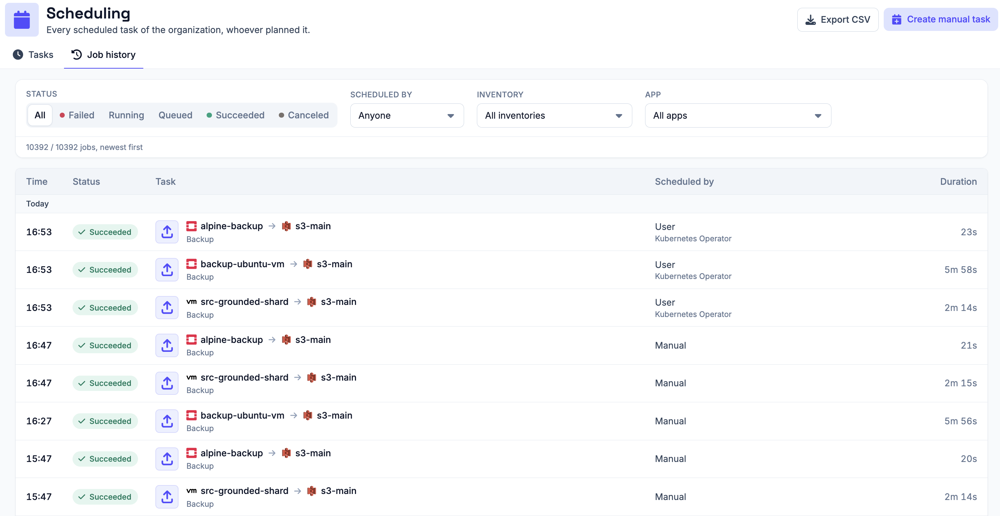
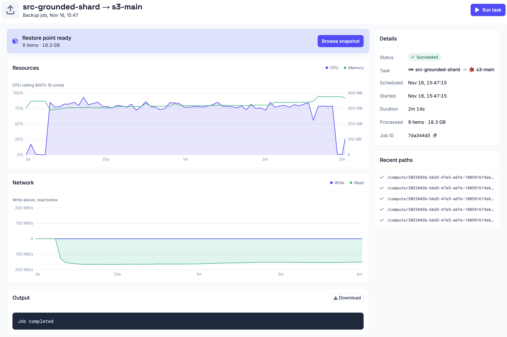
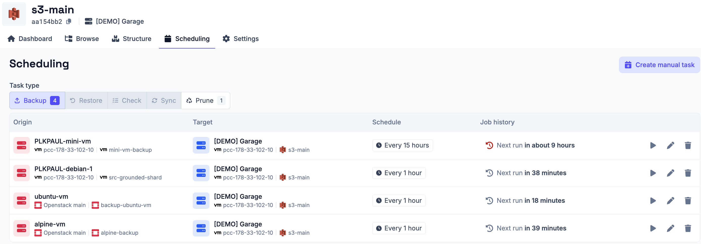
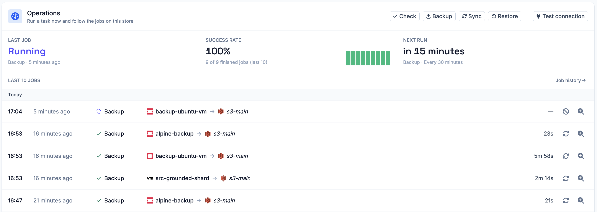
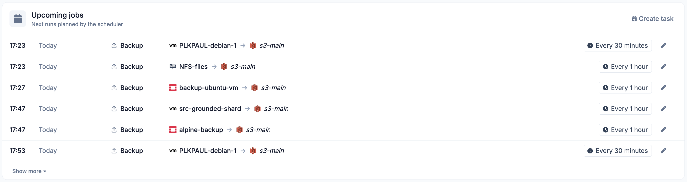

# Job History

The **Job history** tab of **Governance > Scheduling** lists every job of the
organization, whichever scheduler planned it: the
[manual scheduler](../manual-scheduler), the
[policy scheduler](../policy-scheduler) or a
[user scheduler](../user-schedulers). It shows the jobs that have run, whether
they succeeded or failed, and the jobs that are queued or running. The newest
jobs come first, grouped by day, and the list is split into pages.

Each row shows when the job ran, its status, the task with its apps, the
scheduler that planned it and how long it took. A failed job also shows its
error, with a link to open the log. The list can be filtered by status, by the
scheduler that planned the job, by inventory and by app. The job history can be
exported as a CSV file, in full or from a given date.

## Job details

Opening a job shows its details page. When the job produced a restore point, the
page starts with a **Browse snapshot** button that opens it.

- **Details**: the status, the task, when the job was scheduled and started, its
  duration, what it processed so far, and the job ID.
- **Resources**: a graph of CPU and memory usage over the job's runtime.
- **Network**: a graph of network throughput over the job's runtime.
- **Output**: the log output of the job, useful for diagnosing failures.
  **Download** saves the full log.
- **Recent paths**: a live list of the last files processed, each showing
  whether it has `succeeded`, `failed`, or is still in `progress`.

While a job is running, the output and recent paths update in real time, and a
**Cancel job** button stops it.

A job run on an [edge](../../edges) shows the same details. The edge streams
them back while the job runs, and its output also includes the output of the
job's [pre-job and post-job hooks](../../edges/hooks). Cancelling a job on an
edge still runs its post-job hook.

## Jobs and Schedules on Apps

Each app ([sources](../apps/sources), [stores](../apps/stores) &
[destinations](../apps/destinations)) also surfaces scheduling information on
its own details page:

- The **Scheduling** tab lists all schedules that involve that app, so you can
  see at a glance what is configured to run and when.

  

- The **Dashboard** tab lists all past and upcoming jobs involving that app,
  scoped to that app only.

   

