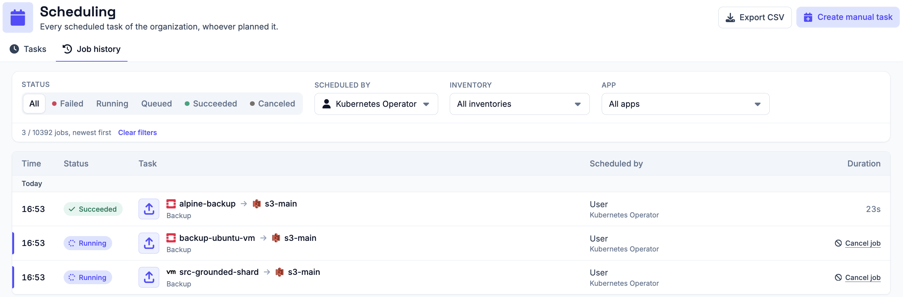

# User Schedulers

Every [Application user](../access-control/users#application-users) can have its
own scheduler. Unlike the [manual](../manual-scheduler) and
[policy](../policy-scheduler) schedulers, a user scheduler is not created from
the UI. Application users authenticate with an API key rather than signing in,
so their scheduler can currently only be created and managed through the Plakar
Control Plane API, using that user's API key.

An Application user has no scheduler by default. It must explicitly create one
through the API before it can schedule any tasks. Once created, the user can
manage its own scheduled tasks independently of the manual and policy
schedulers.

Tasks and jobs of user schedulers appear in **Governance > Scheduling** with
those of the other schedulers. On the **Tasks** tab, the **Users** option of the
**Scheduled by** filter shows only the tasks of user schedulers. It appears once
a user scheduler has a task. On the **Job history** tab, the **Scheduled by**
filter lists each Application user that has a scheduler, to show the jobs of
that user only. See [Job History](../job-history) for monitoring jobs and
viewing their output.

## Kubernetes Operator

The [Kubernetes Operator](../infrastructure-as-code/kubernetes-operator) is
currently the only client that creates a user scheduler. It authenticates as an
Application user and, when it connects to Plakar Control Plane, creates a
scheduler for that user if one doesn't already exist. From then on, every
`ScheduleBackup`, `ScheduleCheck`, and `ScheduleSync` resource it manages
appears as a task scheduled by that user. See
[Scheduling](../infrastructure-as-code/kubernetes-operator/scheduling) for how
the operator represents these tasks and their job history as Kubernetes
resources.

